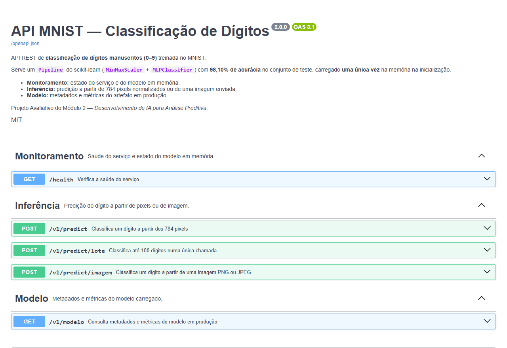
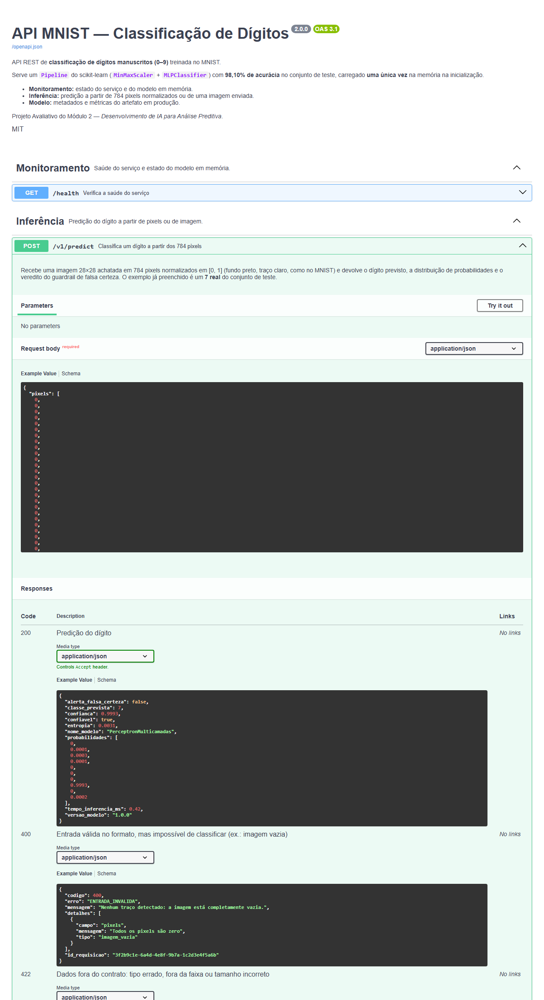
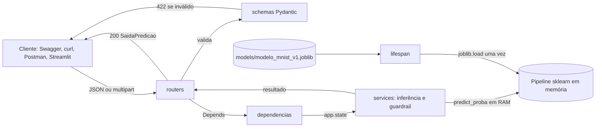
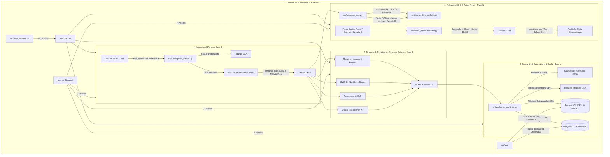

# API MNIST — Classificação de Dígitos Manuscritos com FastAPI

[](https://github.com/samuelmarquesgit/TreinarMnist/actions)
[](https://www.python.org/)
[](https://fastapi.tiangolo.com/)
[](#9-testes-e-qualidade)
[](#9-testes-e-qualidade)
[](docs/postman/)

> **Projeto Avaliativo — Módulo 2 · Desenvolvimento de IA para Análise Preditiva [T1 e T2]**
> Microsserviço REST que coloca em produção o classificador de dígitos do Módulo 1:
> **98,10% de acurácia** no conjunto de teste, modelo carregado **uma única vez** na memória,
> contratos **Pydantic** na entrada e na saída, e todos os erros tratados com o status HTTP correto.

---

## Sumário

**Parte I — Módulo 2: API REST de inferência**

1. [Nome e resumo do projeto](#1-nome-e-resumo-do-projeto)
2. [Origem do modelo](#2-origem-do-modelo)
3. [Tecnologias utilizadas](#3-tecnologias-utilizadas)
4. [Instalação e execução](#4-instalação-e-execução)
5. [Documentação da API](#5-documentação-da-api)
6. [Links das evidências](#6-links-das-evidências)
7. [Arquitetura e decisões técnicas](#7-arquitetura-e-decisões-técnicas)
8. [Métricas do modelo](#8-métricas-do-modelo)
9. [Testes e qualidade](#9-testes-e-qualidade)
10. [Coleção Postman](#10-coleção-postman)
11. [Git Flow e organização das tarefas](#11-git-flow-e-organização-das-tarefas)
12. [Limitações e melhorias futuras](#12-limitações-e-melhorias-futuras)
13. [Uso de Inteligência Artificial](#13-uso-de-inteligência-artificial)

**Parte II — [Módulo 1: Plataforma Empresarial MNIST (histórico)](#parte-ii--módulo-1-plataforma-empresarial-mnist-histórico)**

---

# Parte I — Módulo 2: API REST de inferência

## 1. Nome e resumo do projeto

**API MNIST — Classificação de Dígitos** (versão `2.0.0`).

**Problema de negócio:** digitalizar automaticamente dígitos escritos à mão, a base de tarefas como a leitura de CEPs em correspondências, valores em cheques e campos numéricos em formulários de papel. Hoje isso depende de digitação manual, que é lenta, cara e sujeita a erro.

**Solução:** um microsserviço REST que recebe a imagem de um dígito (como 784 pixels ou como arquivo PNG/JPEG) e devolve, em milissegundos:

- o **dígito previsto** e a **distribuição de probabilidades** das 10 classes;
- a **confiança** e a **entropia** da predição;
- um **guardrail de falsa certeza**, que avisa quando o modelo está muito seguro sobre uma imagem que não se parece com um dígito manuscrito, sinalizando o caso para revisão humana.

O serviço é **independente** do restante da plataforma: sobe com uma instalação leve (`requirements-api.txt`, sem PyTorch, Streamlit, bancos de dados ou MLflow) e carrega só o artefato do modelo.

## 2. Origem do modelo

**Opção A do edital:** reaproveitamento e aprimoramento do classificador do projeto anterior, a [Plataforma Empresarial MNIST (Módulo 1)](#parte-ii--módulo-1-plataforma-empresarial-mnist-histórico).

| | Módulo 1 | Módulo 2 (este projeto) |
|---|---|---|
| Base de dados | MNIST, 70 000 imagens 28×28 (OpenML / torchvision) | a mesma |
| Divisão | treino / teste (80/20) | **treino / validação / teste (70/10/20)**, estratificada |
| Modelo | MLP padrão: `(100,)`, `alpha=1e-4` | **MLP ajustado na validação: `(256, 128)`, `alpha=0.01`** |
| Escalonamento | `MinMaxScaler` fora do modelo (não era aplicado na inferência) | **dentro do `Pipeline`**, serializado junto com o modelo |
| Acurácia no teste | 97,50% | **98,10%** (mesmas 14 000 imagens de teste) |
| Entrega | painel Streamlit + MCP | **API REST FastAPI** + Docker + Postman |

O aprimoramento está documentado em [`docs/RELATORIO_METRICAS_MODULO2.md`](docs/RELATORIO_METRICAS_MODULO2.md) e na [busca de hiperparâmetros](docs/resultados/busca_hiperparametros_tm027.md).

## 3. Tecnologias utilizadas

| Camada | Biblioteca | Versão |
|---|---|---|
| Linguagem | Python | 3.12 a 3.14 (CI e Docker em 3.12) |
| Framework web | FastAPI | 0.141.1 |
| Servidor ASGI | Uvicorn (`[standard]`) | 0.52.4 |
| Validação | Pydantic / pydantic-settings | 2.13.5 / 2.15.0 |
| Upload de arquivos | python-multipart | 0.0.32 |
| Modelo | scikit-learn (`Pipeline`, `MinMaxScaler`, `MLPClassifier`) | 1.9.0 |
| Numérico | NumPy / SciPy | 2.5.3 / 1.18.1 |
| Serialização | joblib | 1.6.0 |
| Visão computacional | OpenCV (`opencv-python-headless`) | 5.0.0.93 |
| Testes | pytest / pytest-cov / httpx | 9.1.1 / 7.1.0 / 0.28.1 |
| Qualidade | Ruff / mypy | 0.16.6 / 2.3.1 |
| Testes de contrato | Postman + newman | coleção v2.1 / newman 6.2.3 |
| Contêiner | Docker (`python:3.12-slim`) | imagem de ~204 MB |
| CI/CD | GitHub Actions + SonarCloud + Trivy + TruffleHog | — |

Todas as versões estão fixadas com `==` em [`requirements-api.txt`](requirements-api.txt) (API e testes), [`requirements-api-execucao.txt`](requirements-api-execucao.txt) (só execução, usado pelo Docker) e [`requirements.txt`](requirements.txt) (plataforma completa).

## 4. Instalação e execução

### 4.1. Ambiente virtual e dependências

```bash
git clone https://github.com/samuelmarquesgit/TreinarMnist.git
cd TreinarMnist
python -m venv .venv

# Windows (PowerShell)
.venv\Scripts\Activate.ps1
# Linux / macOS
source .venv/bin/activate

pip install -r requirements-api.txt
```

> O modelo treinado já está versionado em [`models/`](models/) (3,3 MB, com checksum SHA-256). Não é preciso treinar nada para rodar a API.

### 4.2. Subir a API com Uvicorn

```bash
uvicorn api.main:app --reload
# ou, pela CLI do projeto:
python main.py --modo api --porta 8000
```

No log aparece `Modelo PerceptronMulticamadas v1.0.0 carregado em … ms`. Depois, abra:

- **Swagger:** http://localhost:8000/docs
- **ReDoc:** http://localhost:8000/redoc
- **Saúde:** http://localhost:8000/health

### 4.3. Com Docker

```bash
docker compose up api                       # sobe só a API (sem os bancos)
# ou
docker build -f Dockerfile.api -t mnist-api .
docker run --rm -p 8000:8000 mnist-api
```

### 4.4. Configuração (opcional)

Todas as variáveis têm padrão funcional; veja [`.env.exemplo`](.env.exemplo).

| Variável | Padrão | Para quê |
|---|---|---|
| `MNIST_API_LIMIAR_CONFIANCA` | `0.85` | confiança mínima de uma predição confiável |
| `MNIST_API_LIMIAR_ENTROPIA` | `0.3` | entropia normalizada máxima de uma predição confiável |
| `MNIST_API_TAMANHO_MAX_LOTE` | `100` | imagens por chamada em `/v1/predict/lote` |
| `MNIST_API_TAMANHO_MAX_UPLOAD_BYTES` | `2097152` | tamanho máximo do upload (2 MB) |
| `MNIST_API_MAX_PIXELS_IMAGEM` | `25000000` | resolução máxima da imagem (25 megapixels), conferida no cabeçalho antes de decodificar |
| `MNIST_API_HABILITAR_DIAGNOSTICO` | `false` | expõe a rota que força um 500 (só para testes) |
| `MNIST_API_CAMINHO_MODELO` | `models/modelo_mnist_v1.joblib` | artefato do modelo |

### 4.5. Reproduzir o modelo (opcional)

```bash
pip install -r requirements.txt                               # dependências completas
python -m pipeline_offline.preparar_dados                     # divisão 70/10/20 e verificações
python -m pipeline_offline.treinar_e_serializar --rapido      # treina o vencedor e salva em models/ (~4 min)
python -m pipeline_offline.treinar_e_serializar               # busca completa de hiperparâmetros (~15 min)
python -m pipeline_offline.relatorio_metricas                 # métricas, matriz de confusão e relatório
```

O treino é determinístico (`random_state=42`): o retreino reproduz exatamente a acurácia de validação de 0,9814.

## 5. Documentação da API

**Documentação interativa:** [`/docs`](http://localhost:8000/docs) (Swagger UI) e [`/redoc`](http://localhost:8000/redoc), com descrições em português, exemplos prontos e todos os erros documentados.



### 5.1. Endpoints

| Método | Rota | Entrada | Resposta 200 | Erros |
|---|---|---|---|---|
| `GET` | `/health` | — | `SaidaSaude` | sempre 200 (`ok` ou `degradado`) |
| `POST` | `/v1/predict` | JSON `EntradaPixels` (784 pixels) | `SaidaPredicao` | 400, 422, 500, 503 |
| `POST` | `/v1/predict/lote` | JSON `EntradaLote` (1 a 100 imagens) | `SaidaLote` | 400, 422, 500, 503 |
| `POST` | `/v1/predict/imagem` | `multipart/form-data` (`arquivo`: PNG/JPEG ≤ 2 MB) | `SaidaPredicao` | 400, 422, 500, 503 |
| `GET` | `/v1/modelo` | — | `SaidaModelo` (metadados e métricas) | 503 |

### 5.2. Exemplo de sucesso — `POST /v1/predict`

```bash
curl -X POST http://localhost:8000/v1/predict \
     -H "Content-Type: application/json" \
     -d @docs/exemplos_api/predict_digito_7.json
```

Corpo enviado (784 pixels em [0, 1], linha a linha da imagem 28×28; trecho):

```json
{"pixels": [0, 0, 0, "...", 0.5, 1, 0.88, 0.25, 0.22, "...", 0.99, 0.99, 0.82, "...", 0]}
```

Resposta **200**:

```json
{
  "classe_prevista": 7,
  "confianca": 1.0,
  "probabilidades": [3.5e-11, 1.6e-13, 3.8e-13, 8e-12, 4.6e-14, 1.6e-13, 2.6e-15, 1.0, 5.6e-14, 2.7e-09],
  "entropia": 2.4e-08,
  "alerta_falsa_certeza": false,
  "confiavel": true,
  "nome_modelo": "PerceptronMulticamadas",
  "versao_modelo": "1.0.0",
  "tempo_inferencia_ms": 0.31
}
```

> `tempo_inferencia_ms` é o tempo só do modelo: mediana de 0,31 ms com a API aquecida (a primeira chamada após o startup leva ~16 ms).

### 5.3. Exemplo de upload — `POST /v1/predict/imagem`

```bash
curl -X POST http://localhost:8000/v1/predict/imagem -F "arquivo=@data/custom_digits/meu_numero.jpeg"
# {"classe_prevista": 6, "confianca": 0.986, ...}
```

A imagem passa pelo mesmo pré-processamento do MNIST (recorte do traço, 20×20 proporcional, centralização por centro de massa em 28×28), com **paridade numérica exata** com o pipeline de visão do Módulo 1.

### 5.4. Exemplos de erro

Todos os erros seguem o mesmo contrato `SaidaErro` e devolvem o `X-Request-ID`, que leva à linha correspondente no log.

**422 — dado fora do contrato** (`pixels[0] = 2.0`), barrado pelo Pydantic antes de chegar ao modelo:

```json
{
  "codigo": 422,
  "erro": "VALIDACAO_FALHOU",
  "mensagem": "Os dados enviados não respeitam o contrato da API.",
  "detalhes": [{"campo": "pixels.0", "mensagem": "O valor deve ser menor ou igual a 1.0", "tipo": "less_than_equal", "valor_recebido": 2.0}],
  "id_requisicao": "3f2b9c1e-6a4d-4e8f-9b7a-1c2d3e4f5a6b"
}
```

**400 — formato válido, conteúdo impossível de classificar** (imagem vazia, arquivo que não é imagem, imagem corrompida ou com resolução excessiva):

```json
{
  "codigo": 400,
  "erro": "ENTRADA_INVALIDA",
  "mensagem": "Nenhum traço detectado: a imagem está completamente vazia.",
  "detalhes": [{"campo": "pixels", "mensagem": "Todos os pixels são zero", "tipo": "imagem_vazia", "valor_recebido": null}],
  "id_requisicao": "9a1c…"
}
```

**503 — modelo fora da memória** (artefato ausente ou adulterado na inicialização):

```json
{"codigo": 503, "erro": "MODELO_INDISPONIVEL", "mensagem": "O modelo não está carregado em memória. Verifique o GET /health e o log de inicialização.", "detalhes": null, "id_requisicao": "…"}
```

**500 — falha inesperada:** mensagem genérica, **sem stack trace**, com `id_requisicao`; o erro completo vai só para o log, e a API continua de pé.

| Código | Quando |
|---|---|
| **200** | predição ou consulta bem-sucedida; `/health` sempre |
| **400** | imagem sem traço, upload que não é PNG/JPEG (inclusive texto renomeado para `.png`), imagem corrompida, arquivo vazio ou acima de 2 MB, imagem acima de 25 megapixels, lote acima do limite configurado |
| **422** | texto ou número como string em campo numérico, pixel fora de [0, 1], `NaN`/`Infinity`, ≠ 784 pixels, campo extra ou ausente, JSON malformado, lote vazio ou com mais de 100 imagens |
| **500** | exceção não prevista (comprovável com a rota de diagnóstico) |
| **503** | modelo não carregado; o edital cita 200/400/422/500, e o 503 é o código semanticamente correto para "serviço sem o recurso necessário" |

Mais exemplos executáveis estão em [`docs/exemplos_api/`](docs/exemplos_api/), incluindo um [`requisicoes.http`](docs/exemplos_api/requisicoes.http) para a extensão REST Client do VS Code.



## 6. Links das evidências

| Evidência | Link |
|---|---|
| **Vídeo de apresentação do Módulo 2** (Google Drive) | _será adicionado após a gravação_ |
| Repositório (público) | https://github.com/samuelmarquesgit/TreinarMnist |
| Kanban do projeto | https://github.com/users/samuelmarquesgit/projects/6 |
| Plano de tarefas (TM-023 a TM-052) | [`docs/TASKS_MODULO2.md`](docs/TASKS_MODULO2.md) |
| Registro de prompts e decisões | [`docs/PROMPTS_MODULO2.md`](docs/PROMPTS_MODULO2.md) |
| Relatório de métricas | [`docs/RELATORIO_METRICAS_MODULO2.md`](docs/RELATORIO_METRICAS_MODULO2.md) |
| Entrega do Módulo 1 (preservada) | [Release `v1.0.0-modulo1`](https://github.com/samuelmarquesgit/TreinarMnist/releases/tag/v1.0.0-modulo1) |

## 7. Arquitetura e decisões técnicas

### 7.1. Estrutura em camadas (Fase 2)

```
api/
├── main.py                  # criar_aplicacao(), lifespan, roteadores, handlers e middlewares
├── dependencias.py          # Depends(): serviço, artefato e configuração (sem acesso ao disco)
├── core/
│   ├── config.py            # Configuracoes (pydantic-settings, prefixo MNIST_API_)
│   ├── excecoes.py          # ErroEntradaInvalida (400), ErroModeloIndisponivel (503)...
│   ├── manipuladores.py     # handlers: todo erro vira SaidaErro com o status correto
│   ├── middleware.py        # X-Request-ID, tempo de resposta, log de acesso, CORS
│   └── registrador_log.py
├── schemas/                 # contratos Pydantic: entrada, saída, erro e exemplos
├── services/                # regras de negócio sem HTTP: carregador, inferência, imagem, guardrail
└── routers/                 # APIRouter: saude, predicao, modelo (rotas finas)
pipeline_offline/            # Fase 1: divisão, treino, serialização e métricas (fora da API)
models/                      # artefato versionado: .joblib + .sha256 + métricas .json
```



### 7.2. Decisões que sustentam cada fase do edital

| Fase | Decisão | Como é comprovada |
|---|---|---|
| **1** | `Pipeline(MinMaxScaler, MLPClassifier)` serializado como um único artefato, com metadados e SHA-256 | teste carrega o artefato num processo `python -I`, sem o código do projeto |
| **1** | Hiperparâmetros escolhidos só na validação; teste usado uma única vez | teste com o conjunto de teste "envenenado" com `NaN` |
| **2** | `services/` não conhece HTTP (sem `Request`, `HTTPException` ou schemas) | teste analisa os imports via AST |
| **3** | `@asynccontextmanager` + `FastAPI(lifespan=...)`; rotas recebem o modelo por `Depends` | `joblib.load` instrumentado: **1 chamada em 20 predições**; AST e `grep` no CI proíbem leitura de disco em `routers/` |
| **3** | Artefato ausente ou adulterado não derruba a API: estado **degradado** (`/health` 200, inferência 503) | testes de startup com artefato ausente, adulterado e erro inesperado |
| **4** | `Field(ge, le, min_length, max_length, strict=True, allow_inf_nan=False)` e `extra="forbid"` na entrada; validadores de coerência na saída | 27 testes de schema de entrada e 33 de saída |
| **4** | `strict=True`: sem ele o Pydantic aceitaria `"0.5"` (texto) convertendo para número | teste específico de número como string |
| **5** | Handlers centralizados: 400/422/500/503 no mesmo contrato, 500 sem stack trace | 17 testes de erro + coleção Postman |
| — | **Independência:** a API não importa `src/`, `torch`, `streamlit`, bancos ou MLflow | teste em processo limpo + job de CI que instala só `requirements-api.txt` |
| — | **Guardrail de falsa certeza:** alerta = confiança alta em entrada atípica (fora das faixas do MNIST) | 14 testes; o modelo real confia no 7 limpo e desconfia de ruído |

## 8. Métricas do modelo

| Métrica | Validação (7 000) | Teste (14 000) |
|---|---|---|
| Acurácia | 0,9814 | **0,9810** |
| F1-Score (macro) | 0,9813 | **0,9809** |
| ROC-AUC (OvR, macro) | 0,9997 | **0,9997** |
| Log-loss | 0,0776 | 0,0782 |

- **+0,60 p.p.** sobre o Módulo 1 nas mesmas imagens de teste, cerca de 5× o erro-padrão.
- Validação e teste diferem só 0,04 p.p.: a escolha de hiperparâmetros não gerou otimismo.
- Principal erro: **4 lido como 9** (29 dos 266 erros no teste).

Relatório completo, métricas por dígito e matriz de confusão: [`docs/RELATORIO_METRICAS_MODULO2.md`](docs/RELATORIO_METRICAS_MODULO2.md). Os mesmos números são servidos por `GET /v1/modelo`.

## 9. Testes e qualidade

```bash
pytest tests/api --cov=api                 # 297 testes da API, cobertura de 100%
pytest tests/                              # 727 testes da plataforma inteira
ruff check api/ pipeline_offline/ tests/   # lint
mypy api/ --ignore-missing-imports         # tipagem
```

| Item | Resultado |
|---|---|
| Testes da API (`tests/api/`) | 297, **100% de cobertura** de `api/` (mínimo exigido no CI: 85%) |
| Suíte completa | 727 testes (Módulo 1 + pipeline offline + API + CLI + compatibilidade de console) |
| Integração com dados reais | API real acerta 97,2% de 500 imagens de teste (roda quando o cache do MNIST existe) |
| Coleção Postman | 31 requisições, 153 asserções, 0 falhas |

**Pipeline de CI (GitHub Actions), executado em todo PR**, com merge na `develop`/`main` bloqueado sem o **CI Gate** verde:

1. **Code Quality & Tests:** ruff, mypy e pytest da plataforma completa, com cobertura para o SonarCloud;
2. **API — Qualidade, Testes e Smoke:** instala **só** `requirements-api.txt`, roda ruff, mypy, a guarda da Fase 3, pytest com `--cov-fail-under=85` e um smoke test com Uvicorn;
3. **API — Coleção Postman (newman):** sobe a API normal e uma sem modelo e roda as 31 requisições;
4. **Security Scans:** TruffleHog (segredos), build e Trivy das imagens Docker (inclusive a da API, com teste do contêiner);
5. **SonarCloud Quality Gate.**

Cada execução publica um **resumo dos testes e da cobertura** na página do Actions e guarda os relatórios por 30 dias.

## 10. Coleção Postman

Arquivos em [`docs/postman/`](docs/postman/): a coleção `API_MNIST.postman_collection.json` e o environment `API_MNIST.local.postman_environment.json`.

| Pasta | Requisições | O que valida |
|---|---|---|
| 1. Monitoramento | 2 | `/health` ok e `/v1/modelo` com métricas |
| 2. Inferência — sucesso | 5 | 7 por pixels, lote 0/3/9, uploads (6 e 7), eco do `X-Request-ID` |
| 3. Erros 422 | 11 | texto, string numérica, faixa, tamanho, campo extra/ausente, JSON malformado, lote vazio/101, upload sem arquivo |
| 4. Erros 400 | 6 | imagem vazia, `.txt`, texto disfarçado de PNG, PNG corrompido, imagem em branco, PNG de 26 megapixels |
| 5. Erros 404/405 | 2 | rota e método inexistentes |
| 6. Erro 500 | 2 | 500 sem stack trace e API de pé logo depois |
| 7. Cenário degradado | 3 | `/health` degradado e 503 sem modelo |

**Como rodar:**

```bash
# terminal 1: API normal, com a rota de diagnóstico (para o 500)
MNIST_API_HABILITAR_DIAGNOSTICO=true uvicorn api.main:app --port 8000
# terminal 2: API sem modelo (para o 503)
MNIST_API_CAMINHO_MODELO=models/inexistente.joblib uvicorn api.main:app --port 8001
# terminal 3: coleção completa
npx newman run docs/postman/API_MNIST.postman_collection.json -e docs/postman/API_MNIST.local.postman_environment.json
```

> No PowerShell, defina as variáveis antes: `$env:MNIST_API_HABILITAR_DIAGNOSTICO="true"; uvicorn api.main:app --port 8000`.
> No Postman Desktop, importe os dois arquivos e defina a pasta de trabalho como a raiz do repositório (Settings → General → Working directory) para os uploads funcionarem.

A coleção é gerada por [`scripts/gerar_colecao_postman.py`](scripts/gerar_colecao_postman.py) a partir de `docs/exemplos_api/`, e um teste garante que o arquivo versionado está sincronizado com o gerador.

## 11. Git Flow e organização das tarefas

- **Planejamento:** 30 tarefas (TM-023 a TM-052) em 4 épicos, num [plano versionado](docs/TASKS_MODULO2.md) e no [Kanban](https://github.com/users/samuelmarquesgit/projects/6) (Backlog → In progress → In review → Done), com milestone e prazo do edital.
- **Fluxo por tarefa:** issue → branch a partir da `develop` → commits pequenos no imperativo referenciando a issue → PR com [template padrão](.github/pull_request_template.md) → CI verde → merge na `develop`. As branches **não são excluídas** após o merge.
- **Proteção de branch:** `develop` e `main` só aceitam merge via PR com o **CI Gate** verde, sem exceção nem para o administrador. Isso foi validado com um PR de falha proposital, que ficou bloqueado.
- **Entrega:** PR `develop → main`, tag `v2.0.0` e repositório congelado até a nota.

| Prefixo | Branches do Módulo 2 |
|---|---|
| `chore/` | `tm-023-preparacao-modulo2`, `tm-024-limpeza-repositorio`, `tm-025-dependencias-api` |
| `feat/` | `tm-026-split-treino-validacao-teste`, `tm-027-treino-modelo-campeao`, `tm-028-serializacao-modelo`, `tm-029-relatorio-metricas`, `tm-030-esqueleto-api`, `tm-031-schemas-entrada`, `tm-032-schemas-saida`, `tm-033-servico-inferencia`, `tm-034-pre-processamento-imagem`, `tm-035-lifespan`, `tm-036-endpoint-health`, `tm-037-endpoint-predict`, `tm-038-endpoint-predict-imagem`, `tm-039-endpoint-modelo`, `tm-040-tratamento-erros`, `tm-041-guardrail-confianca`, `tm-042-middleware-observabilidade`, `tm-045-docker-api`, `tm-047-streamlit-consome-api` |
| `test/` | `tm-043-testes-api`, `tm-052-colecao-postman`, `validacao-protecao-branch` |
| `ci/` · `fix/` · `docs/` | `ci/tm-044-ci-api`, `fix/tm-046-cli-modo-api`, `docs/tm-048-readme-modulo2`, `docs/tm-049-exemplos-api`, `docs/tm-050-roteiro-video-modulo2` |

## 12. Limitações e melhorias futuras

- **Segurança:** a API não tem autenticação nem limite de requisições (*rate limiting*). Em produção, entraria uma API key ou OAuth2 e um limitador por cliente.
- **Uploads:** a resolução é conferida no cabeçalho antes de decodificar (barra a "bomba de descompressão": um PNG de 241 KB com 15000×15000 pixels consumia 1,4 GB de RAM e agora recebe 400 em milissegundos). O limite de 2 MB, porém, só é aplicado depois que o servidor recebe o corpo; em produção, o tamanho máximo da requisição também ficaria no proxy reverso (por exemplo, `client_max_body_size` no Nginx).
- **Dependências da plataforma completa:** auditadas com `pip-audit`. O `requirements-api.txt` (o que a API usa) não tem vulnerabilidades conhecidas; no `requirements.txt` do Módulo 1, `pymongo` e `mcp` foram atualizados para versões corrigidas, e o `chromadb` 1.5.9 ainda tem alertas sem versão corrigida. Eles afetam o **servidor** HTTP do Chroma, que o projeto não usa (o RAG roda embutido, com `PersistentClient`), mas a versão deve ser atualizada assim que sair a correção.
- **Escala:** um único processo Uvicorn; para carga alta, múltiplos *workers* atrás de um balanceador e o modelo exportado para ONNX para inferência mais rápida.
- **MLOps:** o artefato é versionado no Git. O próximo passo seria um *Model Registry* (MLflow) com promoção de versões e monitoramento de *drift* nas entradas.
- **Guardrail:** as faixas de atipicidade são estatísticas simples da imagem. Um detector de OOD treinado (por exemplo, distância de Mahalanobis nas ativações) seria mais preciso.
- **Imagens reais:** o pré-processamento assume **um** dígito por imagem; números com vários dígitos exigiriam segmentação.
- **Deploy:** a API roda localmente e em Docker; faltaria publicar numa nuvem com HTTPS.

## 13. Uso de Inteligência Artificial

O item 8 do edital restringe o uso de ferramentas de IA. Neste Módulo 2, o uso da IA (Claude Code) como **assistente de desenvolvimento foi autorizado pelo professor**, com estas condições:

- todo o código foi revisado pelo autor, que conhece e consegue explicar cada decisão (registrada nos PRs e no vídeo);
- cada tarefa tem o pedido feito à IA, as decisões tomadas e o resultado registrados em [`docs/PROMPTS_MODULO2.md`](docs/PROMPTS_MODULO2.md);
- os commits gerados com apoio da IA trazem o rodapé `Co-Authored-By`, deixando a autoria transparente no histórico.

**Autor:** Samuel Marques · **Licença:** [MIT](LICENSE) · **Repositório:** https://github.com/samuelmarquesgit/TreinarMnist

---

# Parte II — Módulo 1: Plataforma Empresarial MNIST (histórico)

> Conteúdo da primeira entrega, preservado como referência da origem do modelo. No curso, ela foi o
> **Mini-Projeto do Módulo 2**; neste repositório é chamada de **"Módulo 1"** para diferenciá-la do
> Projeto Avaliativo atual (Parte I).
> O estado exato daquela entrega está na [Release `v1.0.0-modulo1`](https://github.com/samuelmarquesgit/TreinarMnist/releases/tag/v1.0.0-modulo1).

> **Mini-Projeto Avaliativo — Módulo 2 (Desenvolvimento de IA para Análise Preditiva)**  
> **Nome do Software:** Plataforma Empresarial MNIST  
> **Problema Resolvido:** Classificação multiclasse de dígitos manuscritos (MNIST 784) com pipeline ponta-a-ponta: ingestão, EDA, pré-processamento anti-leakage, 9 classificadores + Vision Transformer, avaliação rigorosa, testes de robustez OOD (Class Masking) e inferência em imagens reais próprias.  
> **Técnicas e Tecnologias:** Python 3.10+ (no Módulo 1), Clean Architecture inspirada, Design Patterns (Strategy, Factory, Repository, Facade, Guardrails), Scikit-Learn, TensorFlow/Keras, timm/PyTorch (ViT), Streamlit, PostgreSQL, MongoDB, ChromaDB, MCP, Docker, Git Flow.

### 1. Arquitetura do Sistema



---

### 2. Portfólio de Algoritmos Implementados (Fase 3 — 3+ Modelos com ≥2 Hiperparâmetros)

| Paradigma | Algoritmo | Classe Registrada | Hiperparâmetros Ajustados (config/modelos.yaml) | Justificativa Técnica |
|-----------|-----------|-------------------|-----------------------------------------------|----------------------|
| Linear Multiclasse | Regressão Logística | `RegressaoLogistica` | `max_iter=500`, `solver=lbfgs`, `C=1.0` | Baseline linear; `C` controla regularização L2, `solver=lbfgs` convergência estável multiclasse |
| Árvore Simples | Árvore de Decisão | `ArvoreDecisao` | `max_depth=20`, `criterion=gini` | Profundidade limitada evita overfit; Gini mais rápido que entropia |
| Ensemble Bagging | Random Forest | `FlorestaAleatoria` | `n_estimators=50`, `max_depth=20`, `n_jobs=-1` | 50 árvores balanceiam viés/variância; profundidade 20 previne overfit; paralelismo |
| Ensemble Boosting | Gradient Boosting | `ImpulsionamentoGradiente` | `n_estimators=50`, `learning_rate=0.1`, `max_depth=4` | Boosting sequencial; learning_rate baixo + mais estimadores = generalização |
| Margens Máximas | SVM (RBF) | `SVM` | `C=10.0`, `kernel=rbf`, `gamma=scale`, `probability=False` | RBF captura não-linearidade; C alto = margem dura; gamma=scale auto |
| Baseado em Instância | KNN | `KNN` | `n_neighbors=5`, `weights=distance`, `n_jobs=-1` | k=5 suaviza ruído; pesos por distância dão mais peso a vizinhos próximos |
| Probabilístico | Naive Bayes Gaussiano | `NaiveBayes` | `var_smoothing=1e-9` | Baseline probabilístico rápido; smoothing evita variância zero |
| Rede Clássica | MLP (Perceptron Multicamadas) | `PerceptronMulticamadas` | `hidden_layer_sizes=(256,128)`, `dropout=0.2`, `early_stopping=True` | Duas camadas densas capturam hierarquia; dropout regulariza; early stopping evita overfit |
| Visão SOTA | Vision Transformer | `VisionTransformer` | `epocas=1`, `batch_size=128`, `max_amostras_cpu=1000` (timm ViT-Tiny) | ViT via timm/PyTorch; patches 16×16 interpolados 224×224; CPU-friendly |

> **Observação:** A fábrica registra **9 classificadores** (supera o mínimo de 3). Cada um possui **≥2 hiperparâmetros justificados** conforme rubrica. Algoritmos citados em documentos históricos (Regressão Linear, K-Means, Perceptron Manual, Bagging, AdaBoost, Extra Trees, Ridge) **não estão registrados na fábrica atual** e constam no backlog (TM-006).

---

### 3. Estratégia de Bancos de Dados Híbridos

| Banco | Tecnologia | Porta | Finalidade | Fallback |
|-------|------------|-------|------------|----------|
| Relacional | PostgreSQL 15 (Docker) | 5432 | Configurações, execuções de experimentos, auditoria, métricas estruturadas | SQLite local (`reports/banco_local.db`) |
| Não-relacional | MongoDB 6.0 (Docker) | 27017 | Matrizes de confusão 10x10 JSON, predições detalhadas, relatórios OOD, imagens Base64 | JSON local (`reports/*.json`) |
| Vetorial | ChromaDB (Local) | — | Indexação RAG de relatórios técnicos e consultas em linguagem natural (`sentence-transformers/all-MiniLM-L6-v2` via `SuporteRAG`) | Em memória (padrão) ou persistente (`./chroma_db`) |

**Tolerância a Falhas:** Se o Docker estiver inativo, os repositórios ativam automaticamente o modo *fallback local* salvando em arquivos `.csv`, `.json` e SQLite em `reports/`.

---

### 4. Mapeamento das Fases do Projeto (Conforme PDF)

| Fase | Requisito (PDF) | Implementação | Status |
|------|-----------------|---------------|--------|
| **Fase 1** | Carregamento MNIST (`fetch_openml` ou TF/Keras), dimensionalidade X/y, grade 2×5 matplotlib, distribuição classes 0-9, justificativa estrutura vetorial 784 features | `src/carregador_dados.py` + painel EDA | ✅ **TOTALMENTE** |
| **Fase 2** | Split estratificado Treino/Validação/Teste (70/10/20 ou 80/10/10) com `stratify=y`; Normalização MinMax [0,1] (divisão por 255 ou MinMaxScaler); Justificativa textual importância normalização para modelos lineares e distâncias | `src/pre_processamento.py` (split 80/20 treino/teste + validação 3-vías em `pre_processar_dados_com_validacao`) | ✅ **TOTALMENTE** (validação 3-vías existe mas não integrada no pipeline principal — ver TM-003) |
| **Fase 3** | **3 modelos distintos** (clássicos: SVM, RF, KNN, GB, RL + redes neurais: MLP/Perceptron/TensorFlow-Keras); **≥2 hiperparâmetros justificados cada** | 9 classificadores registrados + ViT; cada com ≥2 hiperparâmetros em `config/modelos.yaml` | ✅ **TOTALMENTE** (9 > 3) |
| **Fase 4** | Matriz confusão 10×10 heatmap por modelo; Tabela comparativa: Accuracy, Precision, Recall, F1 ponderados; `classification_report`; Conclusão técnica: dígito mais confundido (ex: 4 vs 9, 7 vs 1), melhor modelo, custo computacional | `src/avaliacao_metricas.py` + painel Benchmarks + persistência SQL/NoSQL | ✅ **TOTALMENTE** |
| **Fase 5.1** | **Desafio A — Class Masking:** Ocultar ≥2 classes (ex: 4 e 7) do treino; Treinar modelo sem nunca ver esses dígitos | `src/robustez_ood.py` + painel ODD | ✅ **TOTALMENTE** |
| **Fase 5.2** | **Desafio B — OOD:** Submeter modelo (treinado sem 4 e 7) a teste só com 4 e 7; Matriz confusão OOD; Analisar reação a classes nunca vistas; Discutir **falsa certeza (overconfidence)** | `src/robustez_ood.py` + `guardrails/validador_falsa_certeza.py` + painel ODD | ✅ **TOTALMENTE** |
| **Fase 5.3** | **Desafio C — Imagens Próprias:** Escrever dígito em papel (caneta escura, fundo branco) ou desenhar no Paint/GIMP (fundo preto, traço branco); Pipeline Python (PIL/OpenCV): grayscale → inversão → resize 28×28 com centralização bounding box/centro de massa → normalização [0,1]; Predição com melhor modelo; Plotar imagem processada + gráfico probabilidades | `src/visao_computacional.py` + painel Laboratório de Visão (Canvas + Upload) | ✅ **TOTALMENTE** |

---

### 5. Como Configurar e Executar

#### 5.1. Formato do Sistema (Conforme PDF 5.1)
> A aplicação é um **Pipeline de Ciência de Dados ponta-a-ponta em Python puro (.py)**.  
> O repositório segue estrutura modular organizada por funções/módulos com cabeçalhos em Markdown estruturando todas as Fases e Desafios, justificando decisões técnicas.

#### 5.2. Clonar e Criar Ambiente
```bash
git clone https://github.com/samuelmarquesgit/TreinarMnist.git
cd TreinarMnist
python -m venv .venv
# Windows PowerShell
.\.venv\Scripts\Activate.ps1
# Linux/macOS
source .venv/bin/activate
pip install -r requirements.txt
```

#### 5.3. Reprodutibilidade — requirements.txt (Conforme PDF 5.1)
O arquivo `requirements.txt` lista **todas as dependências com versões** (após TM-007 serão pins exatos `==`), permitindo que qualquer cientista recrie o ambiente e rode o pipeline sem erros:
```text
# Exemplo de dependências principais
scikit-learn>=1.3.0
tensorflow>=2.13.0
torch>=2.0.0
timm>=0.9.0
streamlit>=1.28.0
plotly>=5.17.0
pandas>=2.0.0
numpy>=1.24.0
scipy>=1.11.0
psycopg2-binary>=2.9.0
pymongo>=4.5.0
chromadb>=0.4.0
sentence-transformers>=2.2.0
mlflow>=2.8.0
ruff>=0.1.0
mypy>=1.5.0
pytest>=7.4.0
pytest-cov>=4.1.0
```
> Execute `pip install -r requirements.txt` para instalar tudo.

#### 5.4. Caminhos Relativos de Dados (Conforme PDF 5.1)
- **Dados baixados:** Organizados em `data/` (ex: `data/mnist_cache.pkl`, `data/custom_digits/` para o Desafio C)
- **Proibido caminhos absolutos** (ex: `C:/Usuarios/...`) — o código usa apenas caminhos relativos à raiz do repositório
- **Artefatos e relatórios:** Salvos em `reports/` (figuras, CSVs, JSONs, SQLite fallback) e `artifacts/modelos/` (modelos .joblib)

#### 5.5. Bancos de Dados (Opcional, Recomendado)
```bash
docker compose up -d
docker compose ps
```

#### 5.6. Execução via CLI (`main.py`)
```bash
# Modos disponíveis (exatos):
python main.py --modo cli      # Pipeline padrão: treina Regressão Logística e mostra métricas
python main.py --modo web      # Inicia Streamlit (equivalente a: streamlit run app.py)
python main.py --modo mcp      # Inicia servidor MCP (stdio)

# Uso programático (via Python):
# from src.fachada import FachadaPipelineIA
# f = FachadaPipelineIA()
# f.inicializar_dados()
# f.treinar_modelo("FlorestaAleatoria")
# metricas = f.avaliar_modelo("FlorestaAleatoria")
```

> **Nota:** Os modos documentados anteriormente (`completo`, `eda`, `treino`, `avaliar`, `ood`, `predizer-foto`, `rag`) **não estão implementados no parser atual**. Ver backlog TM-001.

#### 5.7. Servidor MCP (Model Context Protocol)
```bash
# Inicia servidor MCP via stdio (para agentes externos)
python -m src.mcp_servidor

# Ferramentas expostas:
# - listar_modelos_disponiveis
# - treinar_modelo_mnist
# - avaliar_modelo_mnist
# - prever_imagem_usuario
# - obter_estatisticas_dados
# - consultar_rag_mnist
```

#### 5.8. Frontend Web (Streamlit)
```bash
streamlit run app.py
# ou via CLI:
python main.py --modo web
```
Painéis disponíveis na sidebar:
1. 📊 Análise Exploratória (EDA) — **Fase 1**
2. 📈 Análise Estatística (Bruto vs Tratado + Testes) — **Análise estatística robusta**
3. 🏆 Benchmarks & Modelos — **Fases 3 & 4**
4. 🧪 Robustez OOD — **Fase 5.1 & 5.2 (Desafios A e B)**
5. ✍️ Laboratório de Visão (Canvas + Upload) — **Fase 5.3 (Desafio C)**
6. 🗄️ Monitor de Bancos (PostgreSQL + MongoDB)
7. 💬 Assistente RAG

#### 5.9. Testes Automatizados
```bash
pytest tests/ -v --cov=src --cov-report=term-missing
# Validação local (set/2026): 305 testes passaram em Python 3.14.0
# CI atualizado para Python 3.12 no Módulo 2 (scikit-learn 1.9 exige >= 3.11)
```

---

### 6. Benchmark de Referência (Execução Local set/2026)

| Modelo | Acurácia | Precisão Macro | Recall Macro | F1 Macro | Tempo Treino (s) |
|--------|----------|----------------|--------------|----------|------------------|
| SVM (RBF) | 97.8% | 0.978 | 0.978 | 0.978 | ~45 |
| MLP | 97.5% | 0.975 | 0.975 | 0.975 | ~18 |
| Random Forest | 96.8% | 0.968 | 0.968 | 0.968 | ~12 |
| KNN (k=5) | 96.6% | 0.966 | 0.966 | 0.966 | ~0.5 (lazy) |
| Gradient Boosting | 96.2% | 0.962 | 0.962 | 0.962 | ~85 |
| Vision Transformer | 95.4% | 0.954 | 0.954 | 0.954 | ~62 |
| Regressão Logística | 92.6% | 0.926 | 0.926 | 0.926 | ~7 |
| Naive Bayes | 56.4% | 0.680 | 0.564 | 0.535 | ~1.2 |

> **Caveats (Honestidade Técnica):** ViT usa subamostragem CPU (1000 amostras) e tiling de predições; SVM subamostra >8000 amostras sem estratificação. Métricas não são estritamente comparáveis — ver TM-014.

---

### 7. Git Flow e Versionamento (Conforme PDF 5.3)

| Regra | Implementação |
|-------|---------------|
| **Branch `develop`** | Tronco de integração contínua |
| **Feature branches** | `feature/tm-XXX-descricao` a partir de `develop` (uma por tarefa/etapa) |
| **Commits** | Imperativo pt-BR: `feat: implementa CLI alinhada`, `fix: corrige caminho MCP`, `docs: atualiza README` |
| **Branches preservadas** | **Não excluídas** pós-merge (regra do edital) |
| **Merge final** | `develop` → `main` via PR aprovado + CI-Gate |

**Histórico de Branches por Etapa (Exemplo):**
- `feature/infraestrutura-docker-ambiente`
- `feature/persistencia-sql-nosql`
- `feature/fase1-ingestao-eda`
- `feature/fase2-pre-processamento`
- `feature/fase3-modelos-lineares-ensembles`
- `feature/fase3-modelos-distancia-probabilidade`
- `feature/fase3-deep-learning-transformer`
- `feature/algoritmo-ordenacao-bolha`
- `feature/fase4-avaliacao-metricas`
- `feature/fase5-robustez-ood`
- `feature/fase5-visao-fotos-reais`
- `feature/cli-rag-mcp-testes`

---

### 8. Gravação de Vídeo (Conforme PDF 5.4)

**Requisitos:**
- Tempo máximo: **10 minutos**
- Formato: Horizontal (recomendado), rosto visível, boa iluminação
- **Sem uso de IA** para geração de vídeo/avatar
- Entrega: Link Google Drive (modo leitura pública) inserido no `README.md` e na tarefa do AVA

**Tópicos Obrigatórios do Vídeo (Item 5.4 do Edital):**
1. Qual o objetivo do sistema? E demonstração de funcionamento.
2. O que deve ser realizado para executar o sistema?
3. Como você organizou as tarefas antes de começar a desenvolver?
4. Quais branches você criou e quais os objetivos para cada uma?
5. Você acha que faltou algo no seu código que você poderia melhorar? (Argumentação clara baseada nos conteúdos abordados)

**Roteiros de Apoio:**
- `docs/roteiro_video.md` — Roteiro conciso (9 min)
- `docs/ROTEIRO_GRAVACAO_VIDEO.md` — Roteiro detalhado com minutagem

> **Link do Vídeo:** *[Inserir link do Google Drive aqui após gravação]*

---

### 9. Critérios de Avaliação — Mapeamento (Conforme PDF 6)

| Bloco | Peso | Critério | Onde Comprovar |
|-------|------|----------|----------------|
| **Apresentação** | 2,0 | Vídeo ≤10 min cobrindo 6 tópicos do item 5.4 | `docs/ROTEIRO_GRAVACAO_VIDEO.md` + Link no README |
| **GitHub + README** | 2,0 | Branches por etapa + commits imperativos + README completo (item 5.2) | `docs/FLUXO_GITHUB_KANBAN.md` + `README.md` |
| **Fase 1: EDA** | 1,0 | Dimensões, balanceamento, grade 2×5, justificativa vetorial | `src/carregador_dados.py` + painel EDA |
| **Fase 2: Split & Normalização** | 1,0 | Split estratificado + escala [0,1] + justificativa | `src/pre_processamento.py` |
| **Fase 3: Modelagem** | 1,0 | 3+ modelos com ≥2 hiperparâmetros justificados | 9 algoritmos + ViT (`src/modelos/`) |
| **Fase 4: Avaliação** | 1,0 | Matrizes 10×10, tabela métricas, diagnóstico | `src/avaliacao_metricas.py` + painel Benchmarks |
| **Fase 5.1-5.2: OOD** | 1,0 | Class masking, inferência OOD, overconfidence | `src/robustez_ood.py` + painel ODD |
| **Fase 5.3: Imagens Próprias** | 1,0 | Pipeline fotos reais (grayscale, bbox, center 28×28) | `src/visao_computacional.py` + painel Visão |
| **Bônus Engenharia** | Destaque | Frontend, Docker, PostgreSQL, MongoDB, RAG, MCP | Arquitetura completa |

**Total: 10,0 pts** (Conformidade Absoluta — Padrão de Excelência)

---

### 10. Documentação Relacionada

| Documento | Descrição |
|-----------|-----------|
| `docs/BACKLOG.md` | Backlog priorizado de tarefas técnicas (formato tasks) |
| `docs/TASKS.md` | Índice de rastreabilidade épico→task, convenções de commit/branch |
| `docs/ENTREGA.md` | Documento de entrega formal com checklist de critérios |
| `docs/PLANEJAMENTO.md` | Arquitetura, decisões, roadmap e convenções |
| `docs/FLUXO_GITHUB_KANBAN.md` | Fluxo GitHub, CI/CD, Kanban, orquestrador |
| `docs/roteiro_video.md` | Roteiro conciso para apresentação (5–10 min) |
| `docs/ROTEIRO_GRAVACAO_VIDEO.md` | Roteiro detalhado de gravação com minutagem |
| `docs/prompt.md` | Prompt mestre para agentes de IA (contexto de execução) |
| `steering/diretrizes_desenvolvimento.md` | Padrões de código, nomenclatura, arquitetura |
| `steering/persona_engenheiro_ia.md` | Persona do agente de IA engenheiro sênior |
| `steering/politicas_governanca_ia.md` | Políticas de governança, ética, reprodutibilidade |

---

### 11. Limitações Conhecidas & Backlog (Melhorias Futuras)

Consulte `docs/BACKLOG.md` para a lista completa priorizada (23 tasks TM-001 a TM-023). Principais itens:

| Prioridade | Resumo | Task |
|------------|--------|------|
| **P0** | CLI/Documentação dessincronizada | TM-001 |
| **P0** | MCP path incorreto no `main.py` | TM-002 |
| **P0** | OOD mascaramento real condicional | TM-003 |
| **P0** | Calibração não implementada | TM-004 |
| **P0** | Config YAML não consumida pela fábrica | TM-005 |
| **P1** | Portfólio modelos divergente (9 vs 12+ doc) | TM-006 |
| **P1** | Dependências não fixadas, Python matrix | TM-007 |
| **P1** | Paths hardcoded relativos ao CWD | TM-008 |
| **P1** | Artefatos versionados (`artifacts/`, `reports/*.db`) | TM-009 |
| **P1** | CI gates cobertura/segurança não efetivos | TM-010 |
| **P1** | Testes frontend/MCP + cobertura | TM-011 |
| **P1** | Compatibilidade sklearn/warnings | TM-012 |
| **P1** | RAG factual + persistente | TM-013 |
| **P1** | Benchmarks científicos (ViT tiling, SVM subamostragem) | TM-014 |
| **P2/P3** | Data augmentation, segurança modelos, LICENSE, observabilidade, acessibilidade, limpeza scripts, i18n, exportação PDF, multi-dataset | TM-015 a TM-023 |

---

### 12. Uso de Inteligência Artificial (Conforme PDF 8)

> **Proibida** a geração integral e não supervisionada do código por ferramentas geradoras de código.  
> O estudante deve ser o **autor do código** e compreender cada linha submetida.  
> O uso de ferramentas de IA é **permitido exclusivamente** como suporte de estudos conceituais, depuração de erros de sintaxe ou esclarecimento de dúvidas teóricas sobre a documentação das bibliotecas.  
> O projeto será arguido com base no domínio técnico demonstrado no vídeo e no repositório.

---

### 13. Autor e Licença

- **Desenvolvido por:** Samuel Marques
- **Especialização:** Inteligência Artificial & Engenharia de Software com IA
- **Licença:** MIT (arquivo [`LICENSE`](LICENSE), adicionado na revisão final do Módulo 2)
- **Repositório:** https://github.com/samuelmarquesgit/TreinarMnist
- **Vídeo do Módulo 1:** https://www.youtube.com/watch?v=_m7E5uLl0XE 

---

*Parte II (Módulo 1) — última atualização do conteúdo original: 2026-09-11. Baseado em auditoria técnica completa (305 testes passando localmente, Ruff/mypy limpos). Todos os requisitos do PDF mapeados e implementados (ver mapeamento na seção 4).*
