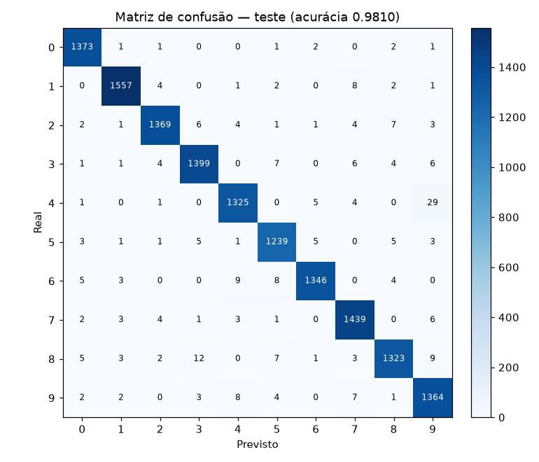

# Relatório de Métricas — Modelo MNIST v1.0.0 (Módulo 2)

> Gerado por `python -m pipeline_offline.relatorio_metricas` · fonte dos números: [`models/metricas_modelo_v1.json`](../models/metricas_modelo_v1.json)

## 1. Modelo avaliado

| Item | Valor |
|---|---|
| Modelo | PerceptronMulticamadas (`MinMaxScaler` → `MLPClassifier`) |
| Camadas ocultas | (256, 128) |
| Regularização L2 (`alpha`) | 0.01 |
| Partições (treino / validação / teste) | 49000 / 7000 / 14000 |
| scikit-learn | 1.9.0 |
| Treinado em | 2026-10-17T23:58:15+00:00 |

Hiperparâmetros escolhidos **só pela validação** ([busca da TM-027](resultados/busca_hiperparametros_tm027.md)); o teste foi usado pela primeira vez neste relatório.

## 2. Métricas globais

| Métrica | Validação | Teste |
|---|---|---|
| Acurácia | 0.9814 | 0.9810 |
| Precisão (macro) | 0.9814 | 0.9809 |
| Recall (macro) | 0.9813 | 0.9808 |
| F1-Score (macro) | 0.9813 | 0.9809 |
| ROC-AUC (OvR, macro) | 0.9997 | 0.9997 |
| Log-loss | 0.0776 | 0.0782 |
| Brier score (médio por classe) | 0.00300 | 0.00305 |

A diferença de acurácia entre validação e teste é de **+0.04 p.p.**, compatível com o ruído amostral: a escolha de hiperparâmetros na validação não gerou otimismo relevante.

## 3. Comparação com o Módulo 1

| | Módulo 1 (MLP padrão) | Módulo 2 (MLP ajustado) | Ganho |
|---|---|---|---|
| Acurácia no teste | 0.9750 | 0.9810 | **+0.60 p.p.** |
| F1 macro no teste | 0.9750 | 0.9809 | **+0.59 p.p.** |

Os dois módulos avaliam **as mesmas 14 000 imagens de teste** (mesma semente, estratificação e 20% de teste; verificado por `tests/test_relatorio_metricas.py`). O ganho é cerca de 5× o erro-padrão da acurácia no teste (~0.12 p.p.). A diferença entre os modelos está nos hiperparâmetros: o Módulo 1 usava uma camada de 100 neurônios com `alpha` padrão (1e-4, `config/modelos.yaml`); o Módulo 2 usa (256, 128) com `alpha=0.01`, escolhidos na validação. Fonte do Módulo 1: README.md §6 — Benchmark de Referência (Módulo 1).

## 4. Desempenho por dígito (teste)

| Dígito | Precisão | Recall | F1 | Suporte |
|---|---|---|---|---|
| 0 | 0.9849 | 0.9942 | 0.9895 | 1381 |
| 1 | 0.9905 | 0.9886 | 0.9895 | 1575 |
| 2 | 0.9877 | 0.9793 | 0.9835 | 1398 |
| 3 | 0.9811 | 0.9797 | 0.9804 | 1428 |
| 4 | 0.9808 | 0.9707 | 0.9757 | 1365 |
| 5 | 0.9756 | 0.9810 | 0.9783 | 1263 |
| 6 | 0.9897 | 0.9789 | 0.9843 | 1375 |
| 7 | 0.9782 | 0.9863 | 0.9823 | 1459 |
| 8 | 0.9815 | 0.9692 | 0.9753 | 1365 |
| 9 | 0.9592 | 0.9806 | 0.9698 | 1391 |

O dígito com menor F1 é o **9** (0.9698).

## 5. Erros mais frequentes (teste)

| Real | Previsto como | Erros |
|---|---|---|
| 4 | 9 | 29 |
| 8 | 3 | 12 |
| 6 | 4 | 9 |
| 8 | 9 | 9 |
| 6 | 5 | 8 |

Dos 266 erros no teste, o par **4 lido como 9** responde por 29 (11%), mais que o dobro do segundo colocado (12). É o principal ponto fraco do modelo; os demais erros estão espalhados entre muitos pares.

## 6. Matriz de confusão (teste)



## 7. Como reproduzir

```bash
python -m pipeline_offline.treinar_e_serializar --rapido   # regenera o artefato (~4 min)
python -m pipeline_offline.relatorio_metricas              # regenera este relatório, o JSON e a imagem
```
