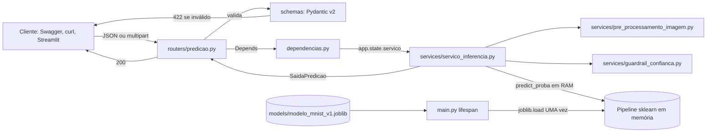
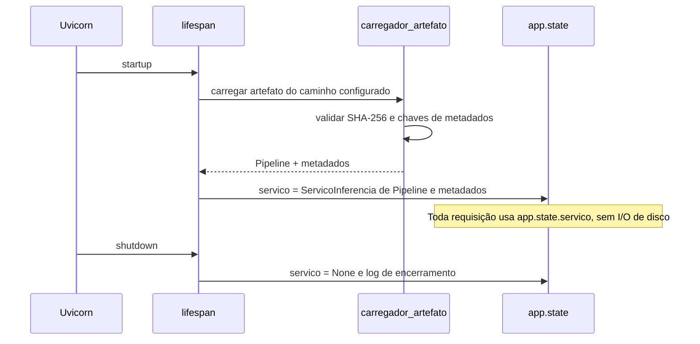
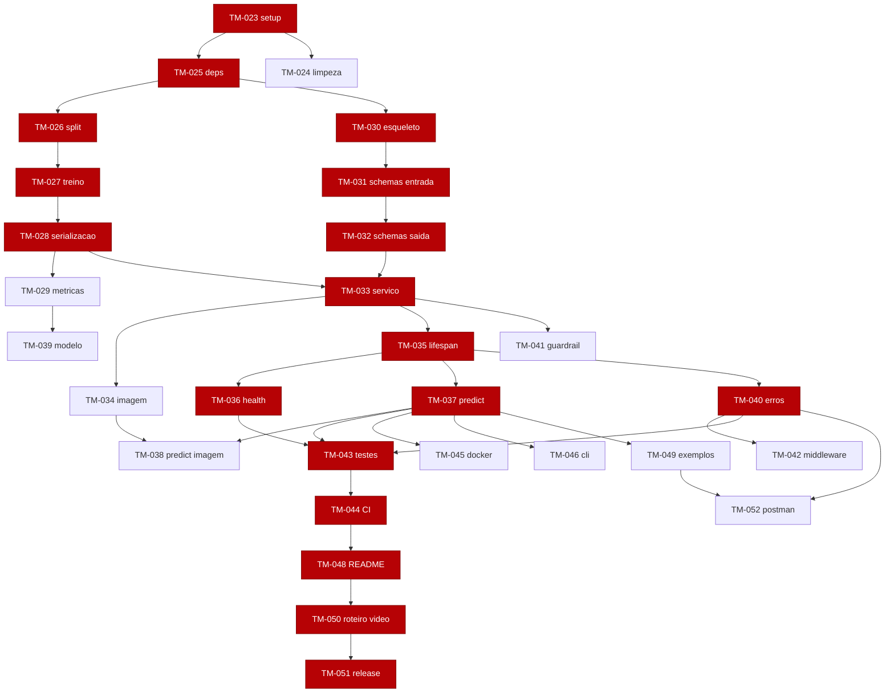

# Plano de Tarefas — Módulo 2: API REST de Inferência MNIST (FastAPI)

> **Versão:** 1.1
> **Data:** 2026-10-17
> **Edital:** *Desenvolvimento de IA para Análise Preditiva [T1 e T2] — Projeto Avaliativo, Módulo 2, Semana 13*
> **Prazo de entrega no AVA:** **03/11/2026 às 22h** (link do GitHub + link do vídeo no Google Drive)
> **Opção escolhida:** **Opção A**, que reaproveita e aprimora o classificador MNIST do projeto anterior (Plataforma Empresarial MNIST)
> **Repositório:** `samuelmarquesgit/TreinarMnist` · **Kanban:** <https://github.com/users/samuelmarquesgit/projects/6>
> **Continuação de:** `docs/BACKLOG.md` e `docs/TASKS.md` (TM-001 a TM-022). Este plano começa em **TM-023**.
> **Registro de prompts:** `docs/PROMPTS_MODULO2.md` (uma entrada por tarefa)

---

## Sumário

1. [Objetivo e princípio de independência](#1-objetivo-e-princípio-de-independência)
2. [Requisitos do edital → tarefas](#2-requisitos-do-edital--tarefas)
3. [Arquitetura alvo](#3-arquitetura-alvo)
4. [Contrato da API](#4-contrato-da-api)
5. [Configuração do GitHub (milestone, labels, épicos, Kanban)](#5-configuração-do-github-milestone-labels-épicos-kanban)
6. [Cronograma (sprints até 03/11)](#6-cronograma-sprints-até-0311)
7. [Tarefas detalhadas](#7-tarefas-detalhadas)
8. [Rastreabilidade Task → Issue → Branch → PR](#8-rastreabilidade-task--issue--branch--pr)
9. [Definition of Done](#9-definition-of-done-dod)
10. [Riscos e mitigação](#10-riscos-e-mitigação)
11. [Checklist final de entrega](#11-checklist-final-de-entrega)

---

## 1. Objetivo e princípio de independência

Disponibilizar o classificador de dígitos MNIST como um **microsserviço REST** em **FastAPI + Uvicorn + Pydantic v2**. A API expõe monitoramento de saúde (`GET /health`) e inferência sob demanda (`POST /v1/predict`), além de inferência por imagem enviada pelo usuário (`POST /v1/predict/imagem`), que retoma o Desafio C do projeto anterior.

### 1.1 Regra de independência (obrigatória)

A API é um **pacote autônomo (`api/`)** que convive com o projeto atual **sem depender dele em tempo de execução**.

| Pode | Não pode |
|---|---|
| Importar `fastapi`, `pydantic`, `pydantic-settings`, `numpy`, `scikit-learn`, `joblib`, `opencv-python-headless` | Importar `src.fachada`, `src.banco_dados`, `src.rag`, `src.frontend`, `src.mcp_servidor`, `agent`, `streamlit`, `torch`, `chromadb`, `sqlalchemy`, `pymongo`, `mlflow` |
| Ler **apenas** o artefato `models/modelo_mnist_v1.joblib` e os metadados `models/metricas_modelo_v1.json` | Ler o dataset MNIST, chamar `inicializar_dados()` ou treinar modelos |
| Subir com `requirements-api.txt` (instalação leve) | Exigir PostgreSQL, MongoDB, ChromaDB ou Docker para funcionar |

**Por quê:** é o que o edital chama de "microsserviço escalável e de baixa latência". A API sobe em segundos e não carrega os ~290 MB de modelos nem o dataset. Também não quebra quando os bancos estão fora do ar.

**Como garantir:** um teste automatizado (TM-043) inspeciona `sys.modules` depois de `import api.main` e falha se algum módulo proibido tiver sido carregado.

### 1.2 Fronteira entre treino (offline) e serviço (online)

- **Pipeline offline (`pipeline_offline/`)**: pode reutilizar `src/carregador_dados.py`, porque roda uma vez na máquina do desenvolvedor. Ele treina, avalia e serializa.
- **Serviço online (`api/`)**: só consome o artefato pronto.
- O artefato é um **`sklearn.pipeline.Pipeline` puro** (escalonador + classificador) com metadados num `dict`. **Não** contém a classe `ModeloSklearn` de `src/modelos`, então o `joblib.load` funciona sem `src/` no `PYTHONPATH`.

---

## 2. Requisitos do edital → tarefas

| Item do edital | Exigência | Tarefas | Peso na nota |
|---|---|---|---|
| **Fase 1** | Treino/validação/teste, pré-processamento, serialização em `models/`, métricas documentadas | TM-026, TM-027, TM-028, TM-029 | 1,0 |
| **Fase 2** | Camadas `schemas/`, `services/`, `routers/`, `main.py` | TM-030 a TM-034, TM-036 a TM-039 | 1,0 |
| **Fase 3** | Modelo carregado **uma vez** via `@asynccontextmanager` + `lifespan`; proibido ler o disco por requisição | TM-035, TM-043 (teste de contagem de `joblib.load`) | 1,0 |
| **Fase 4** | `BaseModel` + `Field` (`ge`, `le`, tamanhos, descrições) na entrada e na saída; 422 automático | TM-031, TM-032, TM-043 | 1,0 |
| **Fase 5** | `GET /health` 200 com o estado do modelo; `POST /v1/predict` 200; 400/422/500 sem crash | TM-036, TM-037, TM-038, TM-040, TM-043 | 1,0 |
| **5.1** | `.py`/`.ipynb` com cabeçalhos Markdown e justificativas; `requirements.txt` com versões; caminhos relativos; pasta de dados | TM-025, TM-026, TM-049 | — |
| **5.2** | README com 6 tópicos obrigatórios | TM-048 | 1,5 |
| **5.3** | `develop`, feature branches sem exclusão, commits no imperativo, tudo em `main` | TODAS + TM-051 | 1,5 |
| **5.4** | Vídeo de até 10 min, com rosto, cobrindo 6 perguntas, sem ferramenta de vídeo com IA | TM-050 | 2,0 |

---

## 3. Arquitetura alvo

### 3.1 Estrutura de pastas (somente o que é novo ou alterado)

```
TreinarMnist/
├── api/                                  # ← NOVO: microsserviço independente
│   ├── __init__.py
│   ├── main.py                           # FastAPI(lifespan=...), routers, handlers de exceção
│   ├── core/
│   │   ├── __init__.py
│   │   ├── config.py                     # Configuracoes (pydantic-settings): caminhos, versões, limiares
│   │   ├── excecoes.py                   # Exceções de domínio da API (ErroImagemInvalida, ...)
│   │   └── registrador_log.py            # Logger estruturado da API
│   ├── schemas/
│   │   ├── __init__.py
│   │   ├── entrada.py                    # EntradaPixels, EntradaLote
│   │   ├── saida.py                      # SaidaPredicao, SaidaLote, SaidaSaude, SaidaModelo
│   │   └── erro.py                       # SaidaErro (contrato único de erro)
│   ├── services/
│   │   ├── __init__.py
│   │   ├── carregador_artefato.py        # Carrega .joblib + valida SHA-256 + metadados
│   │   ├── servico_inferencia.py         # ServicoInferencia.prever()/prever_lote()
│   │   ├── pre_processamento_imagem.py   # bytes → cinza → bbox → 20x20 → 28x28 → vetor 784
│   │   └── guardrail_confianca.py        # entropia + alerta de falsa certeza
│   ├── routers/
│   │   ├── __init__.py
│   │   ├── saude.py                      # GET /health
│   │   ├── predicao.py                   # POST /v1/predict, /v1/predict/lote, /v1/predict/imagem
│   │   └── modelo.py                     # GET /v1/modelo
│   └── dependencias.py                   # Depends(): obter_servico_inferencia(request)
├── pipeline_offline/                     # ← NOVO: Fase 1 (roda uma vez, fora da API)
│   ├── __init__.py
│   ├── preparar_dados.py                 # split 70/10/20 estratificado + checagem de nulos
│   ├── treinar_e_serializar.py           # busca de hiperparâmetros na validação + dump
│   └── relatorio_metricas.py             # métricas de validação/teste + JSON + Markdown
├── models/                               # ← NOVO: artefatos VERSIONADOS no Git (< 50 MB)
│   ├── modelo_mnist_v1.joblib
│   ├── modelo_mnist_v1.sha256
│   └── metricas_modelo_v1.json
├── data/
│   └── custom_digits/                    # imagens próprias (já existe) + exemplos para a API
├── docs/
│   ├── TASKS_MODULO2.md                  # este arquivo
│   ├── RELATORIO_METRICAS_MODULO2.md     # ← NOVO (TM-029)
│   ├── ROTEIRO_VIDEO_MODULO2.md          # ← NOVO (TM-050)
│   └── exemplos_api/                     # ← NOVO (TM-049): payloads JSON + requisicoes.http
├── tests/api/                            # ← NOVO: suíte isolada da API
├── Dockerfile.api                        # ← NOVO (TM-045)
├── requirements-api.txt                  # ← NOVO (TM-025): dependências mínimas e fixas
└── requirements.txt                      # ALTERADO: + fastapi, uvicorn, python-multipart, httpx
```

### 3.2 Fluxo de uma requisição



### 3.3 Ciclo de vida (Fase 3)



Se o artefato não existir ou estiver corrompido, o `lifespan` **não derruba a aplicação**. Ele registra o erro, define `app.state.servico = None`, o `/health` responde `200` com `"modelo_carregado": false` e `"status": "degradado"`, e o `/v1/predict` responde `503`.

---

## 4. Contrato da API

### 4.1 Endpoints

| Método | Rota | Entrada | Saída (200) | Erros mapeados | Tarefa |
|---|---|---|---|---|---|
| GET | `/health` | — | `SaidaSaude` | (sempre 200) | TM-036 |
| POST | `/v1/predict` | `EntradaPixels` (JSON) | `SaidaPredicao` | 400, 422, 500, 503 | TM-037 |
| POST | `/v1/predict/lote` | `EntradaLote` (JSON) | `SaidaLote` | 400, 422, 500, 503 | TM-037 |
| POST | `/v1/predict/imagem` | `multipart/form-data` (`arquivo`: PNG/JPEG ≤ 2 MB) | `SaidaPredicao` | 400, 422, 500, 503 | TM-038 |
| GET | `/v1/modelo` | — | `SaidaModelo` (metadados + métricas) | 503 | TM-039 |
| GET | `/docs`, `/redoc`, `/openapi.json` | — | Documentação automática | — | TM-030 |

### 4.2 Semântica dos códigos HTTP

| Código | Quando | Quem gera |
|---|---|---|
| **200 OK** | Predição ou consulta bem-sucedida; `/health` sempre | Rotas |
| **400 Bad Request** | Dado sintaticamente válido mas **semanticamente impossível**: vetor todo zero (sem dígito), arquivo que não é imagem, imagem corrompida, imagem sem traço, arquivo acima de 2 MB | `ErroEntradaInvalida` → handler |
| **422 Unprocessable Entity** | Tipo errado (texto em campo numérico), pixel fora de `[0, 1]`, `NaN`/`inf`, vetor ≠ 784 posições, lote vazio ou > 100 | Pydantic (automático) com corpo padronizado |
| **500 Internal Server Error** | Falha inesperada na inferência. Corpo genérico **sem stack trace** e com `id_requisicao` para rastrear no log | Handler genérico `Exception` |
| **503 Service Unavailable** | Modelo não está em memória (artefato ausente ou inválido no startup) | `ErroModeloIndisponivel` → handler |

> O edital cita 200/400/422/500. O **503** é um acréscimo semanticamente mais preciso para "modelo fora da RAM". A justificativa vai no README e no vídeo.

### 4.3 Schemas (contrato Pydantic v2)

**Entrada: `EntradaPixels`**

| Campo | Tipo | Restrições (`Field`) | Descrição |
|---|---|---|---|
| `pixels` | `list[float]` | `min_length=784`, `max_length=784`; cada item `ge=0.0`, `le=1.0`, `allow_inf_nan=False` | Imagem 28×28 achatada linha a linha, normalizada em [0, 1] (0 = fundo preto) |

**Entrada: `EntradaLote`**

| Campo | Tipo | Restrições | Descrição |
|---|---|---|---|
| `amostras` | `list[EntradaPixels]` | `min_length=1`, `max_length=100` | Lote de imagens |

**Saída: `SaidaPredicao`**

| Campo | Tipo | Restrições | Descrição |
|---|---|---|---|
| `classe_prevista` | `int` | `ge=0`, `le=9` | Dígito previsto |
| `confianca` | `float` | `ge=0.0`, `le=1.0` | Maior probabilidade |
| `probabilidades` | `dict[str, float]` ou `list[float]` | 10 itens, cada um em [0, 1], soma ≈ 1 | Distribuição por classe |
| `entropia` | `float` | `ge=0.0` | Entropia de Shannon (incerteza) |
| `alerta_falsa_certeza` | `bool` | — | Guardrail: confiança alta + entropia baixa em entrada atípica |
| `confiavel` | `bool` | — | `confianca ≥ limiar` e sem alerta |
| `nome_modelo` | `str` | `min_length=1`, `max_length=64` | Ex.: `PerceptronMulticamadas` |
| `versao_modelo` | `str` | padrão semver `^\d+\.\d+\.\d+$` | Ex.: `1.0.0` |
| `tempo_inferencia_ms` | `float` | `ge=0.0` | Latência da inferência |

**Saída: `SaidaSaude`**: `status` (`Literal["ok", "degradado"]`), `modelo_carregado` (`bool`), `nome_modelo` (`str | None`), `versao_modelo` (`str | None`), `versao_api` (`str`), `tempo_atividade_segundos` (`float`, `ge=0`).

**Saída: `SaidaErro`** (contrato único para 400/422/500/503): `codigo` (`int`, `ge=400`, `le=599`), `erro` (`str`, ex.: `"ENTRADA_INVALIDA"`), `mensagem` (`str`, em pt-BR), `detalhes` (`list[dict] | None`), `id_requisicao` (`str`).

### 4.4 Exemplos

```bash
# Saúde
curl -s http://localhost:8000/health
# {"status":"ok","modelo_carregado":true,"nome_modelo":"PerceptronMulticamadas","versao_modelo":"1.0.0","versao_api":"2.0.0","tempo_atividade_segundos":12.4}

# Predição por pixels (payload de exemplo em docs/exemplos_api/predict_digito_7.json)
curl -s -X POST http://localhost:8000/v1/predict \
     -H "Content-Type: application/json" \
     -d @docs/exemplos_api/predict_digito_7.json

# Predição por imagem própria
curl -s -X POST http://localhost:8000/v1/predict/imagem \
     -F "arquivo=@data/custom_digits/meu_numero.jpeg"

# Erro 422 (pixel fora da faixa)
curl -s -X POST http://localhost:8000/v1/predict -H "Content-Type: application/json" \
     -d '{"pixels":[2.0]}'
```

---

## 5. Configuração do GitHub (milestone, labels, épicos, Kanban)

### 5.1 Milestone e labels (uma única vez)

```bash
# Milestone com prazo do edital
gh api repos/samuelmarquesgit/TreinarMnist/milestones \
  -f title="Módulo 2 — API FastAPI" \
  -f due_on="2026-11-04T00:59:00Z" \
  -f description="Projeto Avaliativo Módulo 2: API REST de inferência MNIST (entrega 03/11/2026 22h BRT)"

# Labels
gh label create "modulo-2"     --color "5319E7" --description "Projeto Avaliativo Módulo 2"
gh label create "api"          --color "0E8A16" --description "Microsserviço FastAPI"
gh label create "fase-1"       --color "FBCA04" --description "Edital: serialização e modelo"
gh label create "fase-2"       --color "FBCA04" --description "Edital: arquitetura modular"
gh label create "fase-3"       --color "FBCA04" --description "Edital: lifespan"
gh label create "fase-4"       --color "FBCA04" --description "Edital: Pydantic"
gh label create "fase-5"       --color "FBCA04" --description "Edital: endpoints e erros"
gh label create "P0" --color "B60205"; gh label create "P1" --color "D93F0B"
gh label create "P2" --color "FBCA04"; gh label create "P3" --color "C5DEF5"
gh label create "chore" --color "BFD4F2"; gh label create "ci" --color "1D76DB"
gh label create "epico" --color "3E4B9E" --description "Issue guarda-chuva com sub-issues"
# (labels feat, fix, docs e test já existem no repositório)
```

### 5.2 Épicos novos (issues "guarda-chuva" com task list)

| Épico | Descrição | Tasks |
|---|---|---|
| **EPIC-14** (#57) | Pipeline offline, serialização e métricas (Fase 1) | TM-026 → TM-029 |
| **EPIC-15** (#58) | API FastAPI: camadas, lifespan, schemas, endpoints, erros (Fases 2–5) | TM-030 → TM-042 |
| **EPIC-16** (#59) | Qualidade, CI/CD e containerização da API | TM-025, TM-043 → TM-047, TM-052 |
| **EPIC-17** (#60) | Documentação, vídeo e entrega do Módulo 2 | TM-023, TM-024, TM-048 → TM-051 |

Cada épico vira uma issue com label `epico`, e as tarefas são vinculadas a ele como **sub-issues** nativas do GitHub. O campo *Sub-issues progress* do Kanban mostra o progresso automaticamente.

### 5.3 Fluxo por tarefa

Todas as issues (TM-023 a TM-052) são criadas de uma vez na TM-023, já com milestone, labels, prioridade e card no Kanban. Depois, cada tarefa segue:

```bash
# 1) Card → In progress e branch a partir de develop
git switch develop && git pull
git switch -c feat/tm-031-schemas-entrada

# 2) Commits pequenos, no imperativo, referenciando a issue
git commit -m "feat: implementa schema EntradaPixels com restrições de faixa (#N)"

# 3) PR para develop com o template padrão (.github/pull_request_template.md)
gh pr create --base develop --title "feat: TM-031 schemas Pydantic de entrada" --body-file <corpo>
#    Card → In review; o CI Gate precisa ficar verde

# 4) Merge (merge commit, NÃO squash, para preservar o histórico de commits)
gh pr merge <PR> --merge          # NUNCA --delete-branch (regra do edital)

# 5) "Closes #N" só fecha sozinho em merges na main → fechar a issue manualmente
gh issue close <N> -c "Entregue no PR #<PR>"   # Card → Done
```

> O `scripts/orquestrador_github.py` do Módulo 1 não é usado: ele monta comandos `gh` com `shell=True` e quebra com acentos e aspas nos títulos.

Colunas do Kanban (projeto 6): `Backlog` → `Ready` → `In progress` → `In review` → `Done`.

---

## 6. Cronograma (sprints até 03/11)

| Sprint | Período | Entregas | Tasks |
|---|---|---|---|
| **S0: Preparação** | 17–18/10 | Proteger a entrega do Módulo 1, configurar o GitHub, limpar o repositório, fixar dependências | TM-023, TM-024, TM-025 |
| **S1: Fase 1** | 19–22/10 | Modelo campeão treinado com validação, serializado e com métricas | TM-026 → TM-029 |
| **S2: Núcleo da API** | 23–27/10 | Camadas, schemas, serviço, lifespan, `/health`, `/v1/predict`, erros | TM-030 → TM-037, TM-040 |
| **S3: Extensões + Qualidade** | 28–30/10 | `/v1/predict/imagem`, `/v1/modelo`, guardrail, testes, CI, Docker | TM-038, TM-039, TM-041 → TM-046 |
| **S4: Documentação** | 31/10–01/11 | README, exemplos, roteiro do vídeo | TM-048 → TM-050 |
| **S5: Entrega** | 02–03/11 | Gravar o vídeo, merge em `main`, tag `v2.0.0`, **congelar o repositório**, submeter no AVA | TM-051 |

> **Caminho crítico (mínimo para nota máxima):** TM-023, TM-025, TM-026 → TM-037, TM-040, TM-043, TM-044, TM-048, TM-050, TM-051. Os demais itens são bônus e podem ser cortados se o prazo apertar (ver §10).

---

## 7. Tarefas detalhadas

Formato de cada tarefa: **Tipo · Prioridade · Épico · Labels · Branch · Depende de**, seguido de descrição, arquivos, critérios de aceite, validação e commits sugeridos.

---

### EPIC-17 / S0: Preparação

#### TM-023 Proteger a entrega do Módulo 1 e configurar o GitHub do Módulo 2
**chore · P0 · EPIC-17 · `modulo-2` · `chore/tm-023-preparacao-modulo2` · —**

O edital considera como data de entrega **a última atualização do repositório** e pede para não modificar o código até a nota sair. Como o Módulo 2 usa o mesmo repositório, é preciso marcar de forma inequívoca o estado entregue no Módulo 1 antes de qualquer push novo.

- [x] Confirmar se a nota do Módulo 1 já foi publicada (**publicada**: o Módulo 2 segue neste repositório)
- [x] Criar a tag anotada `v1.0.0-modulo1` no commit atual de `main` (`fb9efac`) e uma GitHub Release "Entrega Módulo 1"
- [x] Criar o milestone e as labels (§5.1)
- [x] Criar as 4 issues de épico (§5.2) e adicioná-las ao Projeto 6
- [x] Criar as issues TM-023 a TM-052 como sub-issues dos épicos, com milestone, labels, prioridade e tamanho no Kanban
- [x] Criar os templates de PR e de issue em `.github/`
- [x] Fechar os PRs #55 e #56 (base desatualizada); a imagem `bruno_7_com_barra.png` será aproveitada na TM-038
- [x] Commitar este arquivo (`docs/TASKS_MODULO2.md`) e atualizar `docs/TASKS.md` com um link para ele
- [x] Proteger `develop` e `main` (merge só com o check `CI Gate` verde, sem bypass de admin) e ligar o auto-merge; validado com um PR de falha proposital (#92/#93) que ficou bloqueado

**Validação:** `git tag -l "v1*"`; a página Releases mostra a entrega do Módulo 1; o Kanban mostra EPIC-14 a EPIC-17.
**Commits:** `docs: adiciona plano de tarefas do módulo 2` · `docs: referencia plano do módulo 2 no índice de tarefas`

---

#### TM-024 Limpar a raiz do repositório e parar de versionar arquivos locais
**chore · P1 · EPIC-17 · `modulo-2` · `chore/tm-024-limpeza-repositorio` · TM-023** (cobre a antiga TM-020)

O avaliador vai ver o repositório inteiro. Hoje há scripts temporários e bancos locais rastreados.

- [x] Remover `fix_frontend.py`, `fix_mermaid.py`, `fix_test_fachada.py`, `fix_tests.py`, `fix_tests2.py`, `out.log`, `pytest_out.txt`, `imports_test.txt`, `test_pandas.log`, `mypy_errors.txt`, `fake_dir/` (ou mover para `scripts/legado/` se tiverem valor histórico)
- [x] `git rm --cached mlflow.db reports/banco_local.db reports/historico_chat.json` (já estão no `.gitignore`, mas continuam rastreados). Também `artifacts/modelos/RegressaoLogistica.joblib`; `reports/` mantida com `.gitkeep`
- [x] Ajustar o `.gitignore`: manter `artifacts/` ignorado e **liberar `models/`** por lista permitida (`modelo_mnist_v*.joblib`, `.sha256`, `metricas_modelo_v*.json`, `README.md`)
- [x] Garantir que `.env` não está rastreado (`git ls-files .env` vazio)
- [x] Corrigir `tests/test_fachada.py`, que gravava benchmarks em `fake_dir/` na raiz a cada execução (agora usa `tmp_path`)

**Validação:** `git status` limpo; `git ls-files | grep -E "fix_|\.db$|\.log$"` vazio.
**Commits:** `chore: remove scripts temporários da raiz` · `chore: deixa de versionar bancos locais` · `chore: libera pasta models no gitignore`

---

### EPIC-16 / S0: Dependências

#### TM-025 Fixar as dependências da API e do projeto
**chore · P0 · EPIC-16 · `modulo-2`, `api` · `chore/tm-025-dependencias-api` · TM-023** (cobre parte da TM-007)

O edital (5.1) exige um `requirements.txt` com versões que permita recriar o ambiente sem erros.

- [x] Instalar no venv: `pip install fastapi "uvicorn[standard]" python-multipart httpx pydantic-settings` (já estavam instalados)
- [x] Criar `requirements-api.txt` **somente** com o necessário para a API e os testes dela, todas as versões com `==` (tiradas de `pip freeze`): `fastapi`, `uvicorn[standard]`, `pydantic`, `pydantic-settings`, `python-multipart`, `numpy`, `scikit-learn`, `joblib`, `opencv-python-headless`, `httpx`, `pytest`, `pytest-cov`
- [x] Adicionar os mesmos pacotes ao `requirements.txt` geral, fixar todas as versões com `==` e remover as duplicatas (`pydantic` 2×, `mcp` 2×) e o `langsmith`, que não é usado
- [x] **Usar exatamente a versão de `scikit-learn` que serializou o modelo** (um `joblib` gerado numa versão pode falhar ou dar aviso em outra)
- [x] Documentar a versão de Python suportada: **3.12 a 3.14** (o scikit-learn 1.9 exige ≥ 3.11, mas numpy 2.5 e scipy 1.18 exigem ≥ 3.12; CI e Docker em **3.12**, ambiente local em 3.14)
- [x] Atualizar o job existente do CI e o `Dockerfile` de 3.10 para 3.12 (senão as versões fixadas não instalam) e incluir `chore/**` e `ci/**` nos gatilhos
- [x] Validar as duas listas num contêiner `python:3.12-slim`: 45 pacotes (API) e 178 (completo) resolvidos sem conflito

**Validação:** venv novo → `pip install -r requirements-api.txt` → `pip check` sem conflitos → `python -c "import fastapi, sklearn; print(fastapi.__version__, sklearn.__version__)"`.
**Commits:** `chore: adiciona requirements da api com versões fixas` · `chore: remove dependências duplicadas do requirements`

---

### EPIC-14 / S1: Fase 1, pipeline offline e serialização

#### TM-026 Implementar split estratificado treino/validação/teste
**feat · P0 · EPIC-14 · `modulo-2`, `fase-1` · `feat/tm-026-split-treino-validacao-teste` · TM-025**

O projeto anterior usa **apenas treino/teste (80/20)**. O edital do Módulo 2 exige **treino, validação e teste**.

- [x] Criar `pipeline_offline/preparar_dados.py` com `dividir_treino_validacao_teste(X, y, proporcoes=(0.70, 0.10, 0.20), semente=42)` usando dois `train_test_split` estratificados
- [x] Reutilizar `src.carregador_dados.carregar_dados_mnist()` (o offline **pode** depender de `src/`)
- [x] Verificar e registrar **imputação de nulos**: `np.isnan(X).sum() == 0` e o motivo (pixels não têm valores ausentes)
- [x] Registrar por que **não há codificação categórica**: features são intensidades numéricas; o alvo 0–9 já é inteiro
- [x] Registrar que o **escalonamento** fica dentro do `Pipeline` (TM-028) e é ajustado só no treino, sem vazamento
- [x] Verificar o balanceamento das classes nas três partições (diferença de proporção < 0,5 p.p.; no MNIST real: **0,008 p.p.**)
- [x] Cabeçalhos no estilo `# %% [markdown]` com as justificativas (edital 5.1)

**Validação:** `python -m pipeline_offline.preparar_dados` mostra 49 000 / 7 000 / 14 000 amostras e as proporções por classe; teste unitário verifica a ausência de interseção entre as partições.
**Commits:** `feat: implementa divisão estratificada treino validação teste` · `test: verifica ausência de interseção entre partições`

---

#### TM-027 Treinar e ajustar o modelo campeão com o conjunto de validação
**feat · P0 · EPIC-14 · `modulo-2`, `fase-1` · `feat/tm-027-treino-modelo-campeao` · TM-026**

**Modelo escolhido: `PerceptronMulticamadas` (MLPClassifier).** Ele tem 97,5% de acurácia no benchmark do Módulo 1, ocupa cerca de 2,8 MB (cabe no Git), tem `predict_proba` nativo (necessário para a confiança e o guardrail) e infere em milissegundos.
**Alternativas descartadas:** SVM (sem `predict_proba` com `probability=False`, 20 MB), KNN (176 MB, acima do limite do GitHub, e lento na inferência), ViT (depende de PyTorch e quebraria a independência da API).

- [x] `pipeline_offline/treinar_e_serializar.py`: `Pipeline([("escalonador", MinMaxScaler()), ("classificador", MLPClassifier(...))])`
- [x] Busca de 6 combinações avaliada **na validação**, nunca no teste: `hidden_layer_sizes` ∈ {(256,), (256, 128)}, `alpha` ∈ {1e-4, 1e-3, 1e-2}, `learning_rate_init` = 1e-3. Resultado em [`docs/resultados/busca_hiperparametros_tm027.md`](resultados/busca_hiperparametros_tm027.md): vencedora **(256, 128), alpha=0,01, validação 98,14%**
- [x] Justificar ao menos **2 hiperparâmetros** (capacidade da rede e regularização L2)
- [x] Retreinar a melhor combinação em treino+validação **ou** manter só treino (documentar a escolha): **só treino**, para a acurácia de validação reportada continuar honesta
- [x] Fixar `random_state=42` para reprodutibilidade

**Validação:** o log mostra a tabela de combinações × acurácia de validação e a combinação vencedora.
**Commits:** `feat: implementa busca de hiperparâmetros do MLP na validação`

---

#### TM-028 Serializar o pacote do modelo em `models/`
**feat · P0 · EPIC-14 · `modulo-2`, `fase-1` · `feat/tm-028-serializacao-modelo` · TM-027**

- [x] Salvar com `joblib.dump(..., compress=3)` em `models/modelo_mnist_v1.joblib` **um `dict`** com:
  - `pipeline`: o `Pipeline` sklearn treinado (objetos 100% sklearn, sem classes de `src/`)
  - `metadados`: `nome_modelo`, `versao_modelo="1.0.0"`, `classes=[0..9]`, `n_features=784`, `versao_sklearn`, `versao_python`, `data_treino` (ISO-8601), `hiperparametros`, `semente`
- [x] Gerar `models/modelo_mnist_v1.sha256` (integridade, verificada no `lifespan`), no formato do `sha256sum` com LF (verificado: `sha256sum -c` → OK)
- [x] Garantir tamanho < 50 MB (**3,3 MB**)
- [x] Teste: carregar o artefato num **processo novo sem `src/` importado** e prever uma amostra (`python -I`, sem `src/` nem `pipeline_offline/` em `sys.modules`)
- [x] Opção `--rapido` para retreinar só a combinação vencedora (~4 min); reproduz exatamente a validação de 0,9814
- [x] `.gitattributes`: `.joblib` binário e `.sha256` com LF

**Validação:** `python -I -c "import joblib; p=joblib.load('models/modelo_mnist_v1.joblib'); print(p['metadados'])"` funciona; `sha256sum -c` (Linux) ou `Get-FileHash` (Windows) confere.
**Commits:** `feat: implementa serialização do pipeline com metadados` · `feat: adiciona checksum sha256 do artefato`

---

#### TM-029 Gerar o relatório de métricas do modelo
**feat · P0 · EPIC-14 · `modulo-2`, `fase-1` · `feat/tm-029-relatorio-metricas` · TM-028**

- [x] `pipeline_offline/relatorio_metricas.py` calcula **na validação e no teste**: acurácia, precisão/recall/**F1 macro**, **ROC-AUC OvR macro**, log-loss e matriz de confusão 10×10
- [x] Salvar `models/metricas_modelo_v1.json` (lido pelo `GET /v1/modelo`, sem recalcular nada na API)
- [x] Gerar [`docs/RELATORIO_METRICAS_MODULO2.md`](RELATORIO_METRICAS_MODULO2.md) com tabela, matriz de confusão (imagem em `docs/img/`), análise dos pares mais confundidos (no teste real: 4 → 9 com 29 de 266 erros) e comparação com o Módulo 1 (**98,10% × 97,5%, +0,60 p.p.**, no mesmo conjunto de teste)
- [x] Reaproveitar `src/avaliacao_metricas.calcular_metricas` **no offline** para manter consistência com o Módulo 1
- [x] Verificar (por teste) que o conjunto de teste é idêntico ao do Módulo 1, o que torna a comparação direta

**Validação:** o JSON contém as chaves `validacao` e `teste`, cada uma com `acuracia`, `f1_macro`, `roc_auc_ovr` e `matriz_confusao`; o Markdown renderiza no GitHub.
**Commits:** `feat: implementa relatório de métricas de validação e teste` · `docs: adiciona relatório de métricas do módulo 2`

---

### EPIC-15 / S2: API FastAPI

#### TM-030 Criar o esqueleto do pacote `api/` e a configuração
**feat · P0 · EPIC-15 · `api`, `fase-2` · `feat/tm-030-esqueleto-api` · TM-025**

- [x] Criar a estrutura da §3.1 com `__init__.py` em todos os subpacotes (`core`, `schemas`, `services`, `routers`; os módulos internos entram nas tarefas seguintes)
- [x] `api/core/config.py`: classe `Configuracoes(BaseSettings)` com prefixo `MNIST_API_`: `caminho_modelo="models/modelo_mnist_v1.joblib"`, `caminho_metricas`, `caminho_checksum`, `versao_api="2.0.0"`, `limiar_confianca=0.85`, `limiar_entropia=0.3`, `tamanho_max_upload_bytes=2_097_152`, `tamanho_max_lote=100`
- [x] Caminhos **relativos à raiz do projeto**, resolvidos com `Path(__file__).resolve().parents[2]` (nunca `C:/Users/...`), garantido por teste que procura caminhos absolutos em `api/`
- [x] `api/main.py` mínimo: `FastAPI(title="API MNIST — Classificação de Dígitos", version=..., description=...)` com tags OpenAPI em pt-BR, criado pela fábrica `criar_aplicacao(config)` (usada também pelos testes)
- [x] Adicionar `MNIST_API_*` ao `.env.exemplo` (validado: a própria classe de configuração lê o arquivo)
- [x] Antecipar o teste de independência (TM-043): processo limpo com `import api.main` sem `src`, `torch`, `streamlit`, `chromadb`, `sqlalchemy`, `pymongo` ou `mlflow`

**Validação:** `uvicorn api.main:app --reload` sobe; `http://localhost:8000/docs` abre.
**Commits:** `feat: cria estrutura em camadas do pacote api` · `feat: implementa configurações da api com pydantic-settings`

---

#### TM-031 Definir os schemas Pydantic de entrada
**feat · P0 · EPIC-15 · `api`, `fase-4` · `feat/tm-031-schemas-entrada` · TM-030**

- [x] `api/schemas/entrada.py`: `EntradaPixels` e `EntradaLote` conforme §4.3, com `para_matriz()` para o formato `(n, 784) float32`
- [x] Cada pixel com `Annotated[float, Field(ge=0.0, le=1.0, allow_inf_nan=False)]`; lista com `min_length=784`, `max_length=784`. Acrescentado **`strict=True`**: sem ele o Pydantic converteria `"0.5"` (texto) em número
- [x] `model_config = ConfigDict(extra="forbid", json_schema_extra={"examples": [...]})`: campos desconhecidos → 422; exemplo visível no Swagger (**dígito 7 real** do teste, em `api/schemas/exemplos.py`, classificado como 7 pelo modelo)
- [x] `description` em pt-BR em todos os campos

**Validação:** testes unitários dos schemas (sem subir a API): texto → `ValidationError`; 783 itens → erro; `1.01` → erro; `NaN` → erro; campo extra → erro.
**Commits:** `feat: implementa schema EntradaPixels com restrições de faixa` · `feat: implementa schema EntradaLote com limite de tamanho`

---

#### TM-032 Definir os schemas de saída e de erro
**feat · P0 · EPIC-15 · `api`, `fase-4` · `feat/tm-032-schemas-saida` · TM-031**

- [x] `api/schemas/saida.py`: `SaidaPredicao`, `SaidaLote`, `SaidaSaude`, `SaidaModelo` (§4.3) com `Field` em **todos** os campos (o edital pune Pydantic usado só na entrada)
- [x] `@model_validator` em `SaidaPredicao`: `probabilidades` com 10 itens e soma ∈ [0,99; 1,01]; `classe_prevista` igual ao argmax
- [x] `api/schemas/erro.py`: `SaidaErro`
- [ ] Usar `response_model=` em todas as rotas e `responses={400: {"model": SaidaErro}, ...}` para documentar os erros no Swagger (preparado: `RESPOSTAS_ERRO_PREDICAO` em `api/schemas/erro.py`; aplicado nas rotas da TM-036/037)

**Validação:** o `/docs` mostra os schemas de resposta, inclusive os de erro; teste unitário do validador de soma.
**Commits:** `feat: implementa schemas de saída da predição e saúde` · `feat: implementa contrato único de erro da api`
---

#### TM-033 Implementar o serviço de inferência
**feat · P0 · EPIC-15 · `api`, `fase-2` · `feat/tm-033-servico-inferencia` · TM-028, TM-032**

- [x] `api/services/carregador_artefato.py`: `carregar_artefato(caminho, caminho_checksum) -> ArtefatoModelo`; valida a existência do arquivo, o SHA-256 e as chaves obrigatórias de `metadados`; lança `ErroArtefatoInvalido`
- [x] `api/services/servico_inferencia.py`: classe `ServicoInferencia(pipeline, metadados)` com `prever(pixels: np.ndarray) -> ResultadoPredicao` e `prever_lote(...)`. **Sem nenhuma referência a HTTP, `Request` ou `HTTPException`** (desacoplamento exigido pela Fase 2)
- [x] Regra de negócio: vetor com soma de pixels = 0 → `ErroEntradaInvalida("Nenhum traço detectado")`
- [x] Medir `tempo_inferencia_ms` com `time.perf_counter()`

**Validação:** testes unitários do serviço com um pipeline falso (`DummyClassifier`), sem FastAPI.
**Commits:** `feat: implementa carregador de artefato com verificação de integridade` · `feat: implementa serviço de inferência desacoplado do http`
---

#### TM-034 Implementar o pré-processamento de imagem dentro da API
**feat · P1 · EPIC-15 · `api`, `fase-2` · `feat/tm-034-pre-processamento-imagem` · TM-033**

Para manter a independência, a API ganha **sua própria versão enxuta** do pipeline de `src/visao_computacional.py` (que só usa `cv2` + `numpy`).

- [x] `api/services/pre_processamento_imagem.py`: `bytes_para_vetor_mnist(conteudo: bytes) -> np.ndarray` com decodificação (`cv2.imdecode`), escala de cinza, inversão automática para fundo preto, binarização, bounding box, redimensionamento para 20×20 preservando a proporção, centralização em 28×28 por centro de massa e normalização [0, 1] → shape `(1, 784)`
- [x] Validar a assinatura do arquivo (*magic bytes* PNG/JPEG), além do `content_type` declarado
- [x] Erros → `ErroEntradaInvalida` (imagem corrompida, sem dígito, formato não suportado)
- [x] Teste de **paridade**: para `data/custom_digits/meu_numero.jpeg`, o vetor da API é igual (`np.allclose`) ao de `src.visao_computacional.processar_imagem_usuario` (só o teste importa `src/`)

**Validação:** teste de paridade verde; teste com bytes aleatórios → `ErroEntradaInvalida`.
**Commits:** `feat: implementa pré-processamento de imagem independente na api` · `test: verifica paridade com pipeline de visão do módulo 1`
---

#### TM-035 Implementar o ciclo de vida (lifespan)
**feat · P0 · EPIC-15 · `api`, `fase-3` · `feat/tm-035-lifespan` · TM-033**

- [x] Em `api/main.py`: `@asynccontextmanager async def ciclo_de_vida(app: FastAPI)`. No startup: registrar `app.state.inicio`, chamar `carregar_artefato(...)` **uma única vez** e guardar `app.state.servico = ServicoInferencia(...)`. No shutdown: liberar a referência e registrar o encerramento
- [x] `FastAPI(lifespan=ciclo_de_vida)`. **Não usar** `@app.on_event("startup")` (obsoleto)
- [x] Falha no carregamento: capturar, registrar com `logger.exception`, `app.state.servico = None`, e a app **continua de pé** (estado degradado)
- [x] `api/dependencias.py`: `def obter_servico(request: Request) -> ServicoInferencia` que lança `ErroModeloIndisponivel` se `None`; as rotas usam `Depends(obter_servico)`
- [x] **Proibido** qualquer `joblib.load`/`open` dentro de `routers/` (verificado por teste e por `grep` no CI)

**Validação:** log de startup com "Modelo PerceptronMulticamadas v1.0.0 carregado em X ms"; teste de contagem (TM-043).
**Commits:** `feat: implementa lifespan com carregamento único do modelo` · `feat: implementa dependência de injeção do serviço de inferência`
---

#### TM-036 Implementar `GET /health`
**feat · P0 · EPIC-15 · `api`, `fase-5` · `feat/tm-036-endpoint-health` · TM-035**

- [x] `api/routers/saude.py` com `APIRouter(tags=["Monitoramento"])`
- [x] Sempre **200 OK** com `SaidaSaude`: `status="ok"` se o modelo está em memória, `"degradado"` se não; `modelo_carregado`, nome e versão do modelo, `versao_api`, `tempo_atividade_segundos`
- [x] Não executa inferência nem acessa o disco

**Validação:** `curl /health` → 200 nos dois cenários (com e sem artefato).
**Commits:** `feat: implementa endpoint de saúde com estado do modelo`
---

#### TM-037 Implementar `POST /v1/predict` e `POST /v1/predict/lote`
**feat · P0 · EPIC-15 · `api`, `fase-5` · `feat/tm-037-endpoint-predict` · TM-035, TM-032**

- [x] `api/routers/predicao.py` com `APIRouter(prefix="/v1", tags=["Inferência"])`
- [x] `POST /predict`: recebe `EntradaPixels`, converte para `np.ndarray (1, 784) float32`, chama `servico.prever`, devolve `SaidaPredicao` com **200**
- [x] `POST /predict/lote`: até 100 amostras numa única chamada vetorizada a `predict_proba`
- [x] Rotas **finas**: sem lógica de ML, só conversão + chamada ao serviço
- [x] `summary`, `description` e `response_description` em pt-BR; exemplos no Swagger

**Validação:** no `/docs`, "Try it out" com o exemplo → 200 e classe correta.
**Commits:** `feat: implementa endpoint de predição por pixels` · `feat: implementa endpoint de predição em lote`
---

#### TM-038 Implementar `POST /v1/predict/imagem`
**feat · P1 · EPIC-15 · `api`, `fase-5` · `feat/tm-038-endpoint-predict-imagem` · TM-034, TM-037**

- [ ] `arquivo: UploadFile = File(..., description="Imagem PNG ou JPEG de um dígito")`
- [ ] Validar o `content_type` ∈ {`image/png`, `image/jpeg`} e o tamanho ≤ `tamanho_max_upload_bytes` → senão **400**
- [ ] `await arquivo.read()` → `bytes_para_vetor_mnist` → `servico.prever`
- [ ] Usar como exemplo de demonstração a imagem própria do Módulo 1 (`data/custom_digits/meu_numero.jpeg`) e incluir 2 ou 3 novas (ex.: `digito_3_caneta.jpg`, `digito_7_papel.png`)

**Validação:** upload pelo Swagger → 200; upload de `.txt` → 400; upload de imagem em branco → 400.
**Commits:** `feat: implementa endpoint de predição por upload de imagem` · `chore: adiciona imagens próprias de exemplo para a api`

---

#### TM-039 Implementar `GET /v1/modelo`
**feat · P2 · EPIC-15 · `api` · `feat/tm-039-endpoint-modelo` · TM-029, TM-035**

- [ ] Devolver os metadados do artefato + o conteúdo de `metricas_modelo_v1.json`, **carregado no lifespan** junto com o modelo (nada de ler o disco na rota)
- [ ] `SaidaModelo` com `metricas_teste: Metricas` (acurácia, F1, ROC-AUC) e `hiperparametros: dict[str, Any]`

**Validação:** `curl /v1/modelo` mostra as mesmas métricas do relatório da TM-029.
**Commits:** `feat: implementa endpoint de metadados e métricas do modelo`

---

#### TM-040 Implementar o tratamento centralizado de exceções
**feat · P0 · EPIC-15 · `api`, `fase-5` · `feat/tm-040-tratamento-erros` · TM-032, TM-035**

- [x] `api/core/excecoes.py`: `ErroApiMnist` (base) → `ErroEntradaInvalida` (400), `ErroModeloIndisponivel` (503), `ErroArtefatoInvalido` (interno)
- [x] `app.add_exception_handler(...)` em `main.py` para:
  - `ErroEntradaInvalida` → 400 + `SaidaErro`
  - `ErroModeloIndisponivel` → 503 + `SaidaErro`
  - `RequestValidationError` → **422** + `SaidaErro` com `detalhes` traduzidos (campo, mensagem, valor recebido), mantendo o status 422
  - `Exception` → **500** + mensagem genérica, **sem stack trace na resposta**, com `logger.exception` e `id_requisicao`
- [x] Nenhuma rota usa `try/except` genérico: os erros sobem para os handlers
- [x] Rota de diagnóstico `GET /v1/_diagnostico/erro-interno`, que lança uma exceção proposital. Ela só é registrada quando `MNIST_API_HABILITAR_DIAGNOSTICO=true` (padrão `false`, fora do Swagger com `include_in_schema=False`). Serve para provar o 500 no Postman/newman (TM-052) e no vídeo sem alterar código

**Validação:** testes da TM-043 cobrem cada código; forçar um erro interno com `monkeypatch` → 500 com corpo padronizado e servidor de pé.
**Commits:** `feat: implementa hierarquia de exceções da api` · `feat: implementa handlers padronizados para 400 422 500 e 503`
---

#### TM-041 Incluir o guardrail de falsa certeza na resposta
**feat · P1 · EPIC-15 · `api` · `feat/tm-041-guardrail-confianca` · TM-033**

Leva para produção o conceito de *overconfidence* da Fase 5 do Módulo 1.

- [x] `api/services/guardrail_confianca.py`: `avaliar(probabilidades) -> (entropia, alerta_falsa_certeza, confiavel)`, mesma lógica de `guardrails/validador_falsa_certeza.py`, reimplementada na API (independência)
- [x] Limiares vindos da configuração (`limiar_confianca`, `limiar_entropia`)
- [x] Preencher `entropia`, `alerta_falsa_certeza` e `confiavel` em `SaidaPredicao`

**Validação:** teste com probabilidades uniformes → `confiavel=False`; com `[0.99, ...]` → `alerta` conforme a regra.
**Commits:** `feat: implementa guardrail de falsa certeza na resposta da predição`
---

#### TM-042 Adicionar middleware de rastreabilidade e logging
**feat · P2 · EPIC-15 · `api` · `feat/tm-042-middleware-observabilidade` · TM-040** (relaciona-se à TM-018)

- [ ] Middleware HTTP: gera `X-Request-ID` (ou reaproveita o recebido), mede o tempo e devolve `X-Tempo-Processamento-ms`
- [ ] Log estruturado por requisição: método, rota, status, latência, `id_requisicao`. **Nunca registrar os pixels**
- [ ] Opcional: `CORSMiddleware` liberando `http://localhost:8501` (Streamlit)

**Validação:** os headers aparecem na resposta; o log tem uma linha por requisição.
**Commits:** `feat: implementa middleware de id de requisição e tempo de resposta`

---

### EPIC-16 / S3: Qualidade, CI/CD e Docker

#### TM-043 Criar a suíte de testes da API
**test · P0 · EPIC-16 · `api`, `fase-3`, `fase-4`, `fase-5` · `test/tm-043-testes-api` · TM-036, TM-037, TM-040**

`tests/api/` com `conftest.py` que monta um artefato pequeno e temporário (um `Pipeline` treinado em 200 amostras sintéticas), para os testes rodarem no CI sem depender do modelo real.

| Arquivo | Casos |
|---|---|
| `test_schemas.py` | Validações das TM-031/032 sem HTTP |
| `test_saude.py` | 200 com o modelo carregado; 200 + `degradado` com caminho inválido |
| `test_predicao.py` | 200 com payload válido; resposta respeita `SaidaPredicao`; soma das probabilidades ≈ 1; lote 200 |
| `test_erros.py` | **422**: texto, 783 pixels, `1.5`, `NaN`, campo extra, lote vazio, lote com 101 itens · **400**: vetor zerado, upload `.txt`, imagem corrompida, imagem em branco, arquivo > 2 MB · **503**: sem modelo · **500**: exceção forçada, corpo sem stack trace |
| `test_imagem.py` | Upload PNG/JPEG → 200; paridade com o pipeline do Módulo 1 |
| `test_lifespan.py` | **Prova da Fase 3:** `monkeypatch` em `joblib.load` com contador → `with TestClient(app)` + 20 requisições → `contador == 1` |
| `test_independencia.py` | Subprocesso `python -c "import api.main, sys; ..."` → nenhum de {`streamlit`, `torch`, `chromadb`, `sqlalchemy`, `pymongo`, `mlflow`, `src.fachada`} em `sys.modules` |
| `test_integracao_modelo_real.py` | `@pytest.mark.skipif` se `models/modelo_mnist_v1.joblib` não existir; acurácia ≥ 0,95 em 500 amostras de teste |

- [ ] Cobertura de `api/` ≥ **85%**

**Validação:** `pytest tests/api --cov=api --cov-fail-under=85 -v` verde.
**Commits:** `test: adiciona testes dos schemas da api` · `test: adiciona testes de códigos http da api` · `test: verifica carregamento único do modelo no lifespan` · `test: verifica independência de imports da api`

---

#### TM-044 Criar o job de CI da API no GitHub Actions
**chore · P0 · EPIC-16 · `api` · `ci/tm-044-ci-api` · TM-043**

Adicionar ao `.github/workflows/ci.yml` (sem alterar os jobs existentes):

- [ ] Gatilho de push: incluir `'ci/**'` e `'chore/**'` na lista de branches
- [ ] Novo job `api-qualidade-e-testes`:
  1. `actions/setup-python@v5` com Python **3.12** e cache de pip (os jobs existentes também migram de 3.10 para 3.12, porque o scikit-learn 1.9 não suporta 3.10; e as actions em `@main`/`@master` passam a usar versões fixas)
  2. `pip install -r requirements-api.txt ruff mypy` (**instalação leve**, o que já prova a independência)
  3. `ruff check api/ pipeline_offline/ tests/api/`
  4. `mypy api/ --ignore-missing-imports`
  5. Guarda da Fase 3: `! grep -rnE "joblib\.load|open\(" api/routers/` (falha se encontrar)
  6. `pytest tests/api --cov=api --cov-report=xml:coverage-api.xml --cov-fail-under=85`
  7. **Smoke test:** `uvicorn api.main:app --port 8000 &` → aguardar → `curl -f localhost:8000/health` → `curl -f -X POST .../v1/predict -d @docs/exemplos_api/predict_digito_7.json`
- [ ] Incluir `api-qualidade-e-testes` em `needs` do `ci-gate` e na condição de sucesso
- [ ] SonarCloud: `-Dsonar.sources=src/,api/,pipeline_offline/` e somar o relatório `coverage-api.xml`
- [ ] Badge do workflow no README

**Validação:** PR mostra o job verde; um PR de teste com `joblib.load` numa rota faz o job falhar.
**Commits:** `ci: adiciona job de qualidade e testes da api` · `ci: adiciona smoke test do uvicorn no pipeline` · `ci: inclui api no gate e no sonarcloud`

---

#### TM-045 Containerizar a API
**feat · P2 · EPIC-16 · `api` · `feat/tm-045-docker-api` · TM-037**

- [ ] `Dockerfile.api` multi-stage, `python:3.12-slim`, usuário não-root, instala **apenas** `requirements-api.txt`, copia `api/` e `models/`, `EXPOSE 8000`, `HEALTHCHECK` via `/health`, `CMD ["uvicorn", "api.main:app", "--host", "0.0.0.0", "--port", "8000"]`
- [ ] `.dockerignore` (excluir `data/`, `.venv/`, `htmlcov/`, `chroma_db/`, `artifacts/`, `docs/diversos/`)
- [ ] Serviço `api` no `docker-compose.yml` (sem `depends_on` dos bancos, já que a API é independente)
- [ ] CI: `docker build -f Dockerfile.api .` no job de segurança (Trivy)

**Validação:** `docker compose up api` → `curl localhost:8000/health` 200; imagem < 600 MB.
**Commits:** `feat: adiciona dockerfile enxuto da api` · `chore: adiciona serviço api ao docker-compose`

---

#### TM-046 Integrar a API ao `main.py` existente e corrigir o modo MCP
**fix · P2 · EPIC-16 · `api` · `fix/tm-046-cli-modo-api` · TM-037** (resolve a TM-002)

- [ ] `main.py --modo api` → `uvicorn.run("api.main:app", host="127.0.0.1", port=8000)`
- [ ] Corrigir `--modo mcp` para `src.mcp_servidor` (hoje aponta para `src.mcp.servidor`, que não existe)
- [ ] Atualizar o `Dockerfile` geral e o README

**Validação:** `python main.py --modo api` sobe a API; `python main.py --modo mcp` inicia o servidor MCP.
**Commits:** `feat: adiciona modo api à cli principal` · `fix: corrige caminho do módulo do servidor mcp`

---

#### TM-047 (Opcional) Fazer o painel Streamlit consumir a API
**feat · P3 · EPIC-16 · `api` · `feat/tm-047-streamlit-consome-api` · TM-038, TM-042**

Demonstração forte para o vídeo: o Canvas do Laboratório de Visão envia o desenho para `POST /v1/predict/imagem` via `httpx` quando a variável `MNIST_API_URL` estiver definida, com *fallback* para a inferência local.

- [ ] Indicador "🟢 API online / 🔴 offline" baseado em `/health`
- [ ] Teste com `httpx.MockTransport`

**Commits:** `feat: integra laboratório de visão ao endpoint de predição da api`

---

### EPIC-17 / S4–S5: Documentação, vídeo e entrega

#### TM-048 Atualizar o README para o Módulo 2
**docs · P0 · EPIC-17 · `modulo-2` · `docs/tm-048-readme-modulo2` · TM-037, TM-044**

Nova seção principal no topo (o conteúdo do Módulo 1 vira uma seção de histórico), cobrindo **os 6 itens do edital 5.2**:

- [ ] **1. Nome e resumo:** o problema de negócio (digitalização automática de dígitos manuscritos: formulários, CEPs, cheques)
- [ ] **2. Origem do modelo:** Opção A, MLP do projeto *Plataforma Empresarial MNIST* (Módulo 1), aprimorado com split de validação e serialização em Pipeline
- [ ] **3. Tecnologias:** tabela com bibliotecas **e versões** (FastAPI, Uvicorn, Pydantic, pydantic-settings, scikit-learn, NumPy, OpenCV, joblib, pytest)
- [ ] **4. Instalação e execução:** `python -m venv .venv` → ativar (Windows/Linux) → `pip install -r requirements-api.txt` → (opcional) `python -m pipeline_offline.treinar_e_serializar` → `uvicorn api.main:app --reload` → abrir `http://localhost:8000/docs`; mais a alternativa Docker
- [ ] **5. Documentação da API:** tabela de endpoints, payloads JSON de exemplo (sucesso e erros 400/422/503), link `/docs` e `/redoc`, prints do Swagger em `docs/img/`
- [ ] **6. Evidências:** **link do vídeo do Módulo 2** no Google Drive (modo leitor), link da Release `v2.0.0`
- [ ] Extras: diagrama Mermaid da §3.2 (**sem parênteses nos rótulos**), métricas da TM-029, decisões técnicas (independência, 503, guardrail), limitações e melhorias futuras, instruções da coleção Postman (TM-052)
- [ ] Seção **"Uso de Inteligência Artificial"**: o edital (item 8) restringe o uso de IA; registrar que o uso como assistente de desenvolvimento foi **autorizado pelo professor**, com revisão humana de todo o código e o histórico de prompts em `docs/prompt.md`

**Validação:** revisão contra o checklist 5.2; os diagramas Mermaid renderizam no GitHub.
**Commits:** `docs: adiciona seção da api fastapi ao readme` · `docs: adiciona exemplos de payload e prints do swagger`

---

#### TM-049 Criar exemplos executáveis da API
**docs · P1 · EPIC-17 · `modulo-2`, `api` · `docs/tm-049-exemplos-api` · TM-037**

- [ ] `docs/exemplos_api/predict_digito_7.json` (gerado a partir de uma amostra real de teste)
- [ ] `docs/exemplos_api/erro_422_pixel_fora_faixa.json`, `erro_422_tamanho_errado.json`, `erro_400_vetor_vazio.json`
- [ ] `docs/exemplos_api/requisicoes.http` (extensão REST Client do VS Code) com todas as chamadas
- [ ] `scripts/gerar_payload_exemplo.py` para regenerar os JSON

**Commits:** `docs: adiciona payloads de exemplo da api` · `feat: adiciona script gerador de payload de exemplo`

---

#### TM-052 Criar a coleção Postman completa com testes automatizados
**test · P1 · EPIC-16 · `modulo-2`, `api`, `fase-5` · `test/tm-052-colecao-postman` · TM-040, TM-049**

Entrega pedida pelo autor: um arquivo pronto para importar no Postman, cobrindo **todos os endpoints e todos os códigos de erro**, com testes que rodam também no CI.

- [ ] `docs/postman/API_MNIST.postman_collection.json` (formato v2.1) com pastas:
  - **Monitoramento:** `GET /health` (200, `modelo_carregado`, schema)
  - **Inferência — sucesso:** `/v1/predict` dígito 7 (200, `classe_prevista == 7`, soma das probabilidades ≈ 1), `/v1/predict/lote` (200, tamanho do lote), `/v1/predict/imagem` com `meu_numero.jpeg` e `bruno_7_com_barra.png` (200)
  - **Erros 422:** texto no pixel, 783 pixels, pixel `1.5`, pixel negativo, campo extra, corpo vazio, lote vazio, lote com 101 itens
  - **Erros 400:** vetor todo zero, upload `.txt`, imagem corrompida, imagem em branco
  - **Erro 500:** `GET /v1/_diagnostico/erro-interno` (corpo sem stack trace, com `id_requisicao`). Exige a API com `MNIST_API_HABILITAR_DIAGNOSTICO=true`
  - **Metadados:** `GET /v1/modelo` (200, métricas presentes)
- [ ] Cada requisição com `pm.test(...)` validando **status, contrato `SaidaErro`/`SaidaPredicao` e headers** (`X-Request-ID`)
- [ ] `docs/postman/API_MNIST.local.postman_environment.json` com `{{base_url}} = http://localhost:8000`
- [ ] Payloads grandes (784 pixels) gerados no *pre-request script* ou lidos dos arquivos da TM-049, para a coleção ficar legível
- [ ] Job `api-postman` no CI: sobe o uvicorn com o modo diagnóstico ligado e roda `npx newman run ... --reporters cli,junit`; o relatório JUnit vira artefato do workflow
- [ ] Seção no README: como importar a coleção e o environment e como rodar com o newman

**Validação:** `newman run docs/postman/API_MNIST.postman_collection.json -e docs/postman/API_MNIST.local.postman_environment.json` com 0 falhas, localmente e no CI.
**Commits:** `test: adiciona coleção postman da api com testes de sucesso` · `test: adiciona casos de erro 400 422 e 500 na coleção postman` · `ci: executa coleção postman com newman no pipeline`

---

#### TM-050 Escrever o roteiro do vídeo do Módulo 2
**docs · P0 · EPIC-17 · `modulo-2` · `docs/tm-050-roteiro-video-modulo2` · TM-048**

`docs/ROTEIRO_VIDEO_MODULO2.md`, **até 10 min, com rosto, boa iluminação, sem ferramenta de vídeo com IA**:

| Tempo | Pergunta do edital (5.4) | Conteúdo |
|---|---|---|
| 0:00–1:30 | Objetivo do sistema + demonstração | Problema de negócio; Swagger: `/health`, `/v1/predict`, upload da imagem própria; um 422 e um 400 ao vivo |
| 1:30–2:30 | O que fazer para executar | venv → `requirements-api.txt` → `uvicorn api.main:app` (ou `docker compose up api`) |
| 2:30–4:00 | Organização das tarefas | Este documento, épicos EPIC-14 a 17, Kanban (projeto 6), milestone, issues |
| 4:00–5:30 | Branches criadas e objetivo de cada uma | `develop`, `feat/tm-0XX-*`, `test/`, `ci/`, `docs/`; mostrar no GitHub que não foram excluídas; PRs com `Closes #N` |
| 5:30–8:30 | Argumentação técnica das escolhas | Por que MLP; split 70/10/20; Pipeline sem vazamento; **lifespan + teste de contagem**; Pydantic `Field` → 422; 400 × 422 × 500 × 503; independência da API; guardrail de falsa certeza; CI verde |
| 8:30–10:00 | O que poderia melhorar | Ex.: autenticação por API key, rate limiting, MLflow Model Registry, ONNX, monitoramento de *drift*, deploy em nuvem |

- [ ] Ensaiar e cronometrar
- [ ] Subir no Google Drive com o link "qualquer pessoa com o link: leitor"

**Commits:** `docs: adiciona roteiro do vídeo do módulo 2`

---

#### TM-051 Fazer o release final e entregar
**chore · P0 · EPIC-17 · `modulo-2` · PR `develop → main` · todas as P0**

- [ ] Todas as issues P0 fechadas; CI verde em `develop`
- [ ] PR `develop → main` com o resumo das entregas e `Closes` dos épicos
- [ ] Tag `v2.0.0` + GitHub Release "Entrega Módulo 2 — API FastAPI"
- [ ] Teste final **num clone limpo**: `git clone` → venv → `pip install -r requirements-api.txt` → `uvicorn api.main:app` → `/docs` funcionando
- [ ] Atualizar o README com o link do vídeo (último commit **antes** da submissão)
- [ ] **Submeter no AVA até 03/11 às 22h:** link do GitHub (público) + link do vídeo
- [ ] **Congelar o repositório:** nenhum push depois da submissão até a nota sair

**Commits:** `docs: adiciona link do vídeo do módulo 2 ao readme` · `chore: prepara release v2.0.0`

---

## 8. Rastreabilidade Task → Issue → Branch → PR

| Task | Título resumido | Épico | Prior. | Sprint | Issue | Branch | PR | Status (Kanban) |
|---|---|---|---|---|---|---|---|---|
| TM-023 | Proteger Módulo 1 + setup GitHub | 17 | P0 | S0 | #61 | `chore/tm-023-preparacao-modulo2` | #91 | Done |
| TM-024 | Limpar raiz do repositório | 17 | P1 | S0 | #62 | `chore/tm-024-limpeza-repositorio` | #94 | Done |
| TM-025 | Fixar dependências da API | 16 | P0 | S0 | #63 | `chore/tm-025-dependencias-api` | #95 | Done |
| TM-026 | Split treino/validação/teste | 14 | P0 | S1 | #64 | `feat/tm-026-split-treino-validacao-teste` | #96 | Done |
| TM-027 | Treinar modelo campeão (MLP) | 14 | P0 | S1 | #65 | `feat/tm-027-treino-modelo-campeao` | #97 | Done |
| TM-028 | Serializar pacote do modelo | 14 | P0 | S1 | #66 | `feat/tm-028-serializacao-modelo` | #98 | Done |
| TM-029 | Relatório de métricas | 14 | P0 | S1 | #67 | `feat/tm-029-relatorio-metricas` | #99 | Done |
| TM-030 | Esqueleto `api/` + config | 15 | P0 | S2 | #68 | `feat/tm-030-esqueleto-api` | #100 | Done |
| TM-031 | Schemas de entrada | 15 | P0 | S2 | #69 | `feat/tm-031-schemas-entrada` | #101 | Done |
| TM-032 | Schemas de saída e erro | 15 | P0 | S2 | #70 | `feat/tm-032-schemas-saida` | #102 | Done |
| TM-033 | Serviço de inferência | 15 | P0 | S2 | #71 | `feat/tm-033-servico-inferencia` | #103 | Done |
| TM-034 | Pré-processamento de imagem | 15 | P1 | S2 | #72 | `feat/tm-034-pre-processamento-imagem` | | In review |
| TM-035 | Lifespan | 15 | P0 | S2 | #73 | `feat/tm-035-lifespan` | #104 | Done |
| TM-036 | `GET /health` | 15 | P0 | S2 | #74 | `feat/tm-036-endpoint-health` | #105 | Done |
| TM-037 | `POST /v1/predict` (+ lote) | 15 | P0 | S2 | #75 | `feat/tm-037-endpoint-predict` | #108 | Done |
| TM-038 | `POST /v1/predict/imagem` | 15 | P1 | S3 | #76 | `feat/tm-038-endpoint-predict-imagem` | | Backlog |
| TM-039 | `GET /v1/modelo` | 15 | P2 | S3 | #77 | `feat/tm-039-endpoint-modelo` | | Backlog |
| TM-040 | Tratamento de exceções | 15 | P0 | S2 | #78 | `feat/tm-040-tratamento-erros` | #106 | Done |
| TM-041 | Guardrail de falsa certeza | 15 | P1 | S3 | #79 | `feat/tm-041-guardrail-confianca` | #107 | Done |
| TM-042 | Middleware de observabilidade | 15 | P2 | S3 | #80 | `feat/tm-042-middleware-observabilidade` | | Backlog |
| TM-043 | Suíte de testes da API | 16 | P0 | S3 | #81 | `test/tm-043-testes-api` | | Backlog |
| TM-044 | CI da API | 16 | P0 | S3 | #82 | `ci/tm-044-ci-api` | | Backlog |
| TM-045 | Docker da API | 16 | P2 | S3 | #83 | `feat/tm-045-docker-api` | | Backlog |
| TM-046 | `main.py --modo api` + fix MCP | 16 | P2 | S3 | #84 | `fix/tm-046-cli-modo-api` | | Backlog |
| TM-047 | Streamlit consome API (opcional) | 16 | P3 | S3 | #85 | `feat/tm-047-streamlit-consome-api` | | Backlog |
| TM-048 | README Módulo 2 | 17 | P0 | S4 | #86 | `docs/tm-048-readme-modulo2` | | Backlog |
| TM-049 | Exemplos da API | 17 | P1 | S4 | #87 | `docs/tm-049-exemplos-api` | | Backlog |
| TM-050 | Roteiro do vídeo | 17 | P0 | S4 | #89 | `docs/tm-050-roteiro-video-modulo2` | | Backlog |
| TM-051 | Release e entrega | 17 | P0 | S5 | #90 | PR `develop → main` | | Backlog |
| TM-052 | Coleção Postman + newman | 16 | P1 | S3 | #88 | `test/tm-052-colecao-postman` | | Backlog |

### Grafo de dependências (caminho crítico em destaque)



---

## 9. Definition of Done (DoD)

Uma tarefa só vai para **Concluído** quando:

- [ ] Código e identificadores em **pt-BR**, com docstrings no padrão Google
- [ ] Tipagem completa; `mypy api/` sem erros
- [ ] `ruff check` e `ruff format --check` sem apontamentos
- [ ] Testes novos ou atualizados passando; cobertura de `api/` ≥ 85%
- [ ] Nenhum caminho absoluto; nenhum segredo commitado
- [ ] Rotas sem lógica de ML e sem I/O de disco (Fases 2 e 3)
- [ ] Swagger (`/docs`) atualizado com descrições e exemplos
- [ ] PR para `develop` com `Closes #N`, CI verde, branch **mantida** após o merge
- [ ] Commits pequenos, no imperativo (`feat: implementa ...`, `fix: corrige ...`)
- [ ] Documentação afetada atualizada (README, este arquivo, BACKLOG)

### Template de issue

```markdown
## Contexto
<!-- Por que esta tarefa existe; item do edital atendido -->
Referência: docs/TASKS_MODULO2.md#tm-0XX

## Critérios de aceite
- [ ] ...

## Validação
<!-- Comandos ou passos para verificar -->

## Fase do edital
- [ ] Fase 1  - [ ] Fase 2  - [ ] Fase 3  - [ ] Fase 4  - [ ] Fase 5  - [ ] 5.x
```

---

## 10. Riscos e mitigação

| Risco | Impacto | Mitigação |
|---|---|---|
| Push no repositório antes da nota do Módulo 1 alterar a "data de entrega" do Módulo 1 | **Alto** | TM-023: tag `v1.0.0-modulo1` + Release + confirmação com o professor; se necessário, usar um repositório novo |
| Versão do scikit-learn diferente entre o treino e a API | Alto | TM-025 fixa a versão; `versao_sklearn` nos metadados; o lifespan registra um alerta se diferir |
| Artefato não versionado (`artifacts/` está no `.gitignore`) → o avaliador não consegue rodar | Alto | TM-024 libera `models/`; TM-028 mantém < 50 MB; TM-051 testa num clone limpo |
| Divergência entre o pré-processamento do treino e o da inferência | Médio | O escalonador fica **dentro** do Pipeline; teste de paridade da imagem (TM-034) |
| Prazo apertado | Médio | Seguir o caminho crítico; P2/P3 (TM-039, 042, 045, 046, 047) podem ser cortados sem perder nota |
| CI lento por instalar o `requirements.txt` completo (torch etc.) | Baixo | O job da API usa só `requirements-api.txt` |
| API cair por exceção não tratada | Alto (Fase 5) | TM-040 com handler genérico + teste de 500 forçado |

---

## 11. Checklist final de entrega

- [ ] `models/modelo_mnist_v1.joblib` versionado; métricas em JSON e em Markdown
- [ ] `api/` com `schemas/`, `services/`, `routers/`, `main.py`
- [ ] Modelo carregado **uma vez** no `lifespan` (provado por teste)
- [ ] Pydantic com `Field` na entrada e na saída; 422 consistente
- [ ] `/health` 200 com o estado do modelo; `/v1/predict` 200; 400/422/500 tratados
- [ ] `requirements.txt` e `requirements-api.txt` com versões fixas
- [ ] Coleção Postman em `docs/postman/` cobrindo 200/400/422/500/503, com newman verde no CI
- [ ] Nenhum caminho absoluto; imagens próprias em `data/custom_digits/`
- [ ] README com os 6 itens do 5.2 + link do vídeo
- [ ] Branches `feat/*` mantidas; tudo mergeado em `main`; tag `v2.0.0`
- [ ] Vídeo ≤ 10 min, com rosto, cobrindo as 6 perguntas; Drive em modo leitor
- [ ] Links submetidos no AVA **até 03/11/2026 às 22h**
- [ ] Repositório congelado até a publicação da nota

---

*Documento criado em 2026-10-17. Atualize a coluna "Issue/PR/Status" da §8 conforme as issues forem abertas.*
